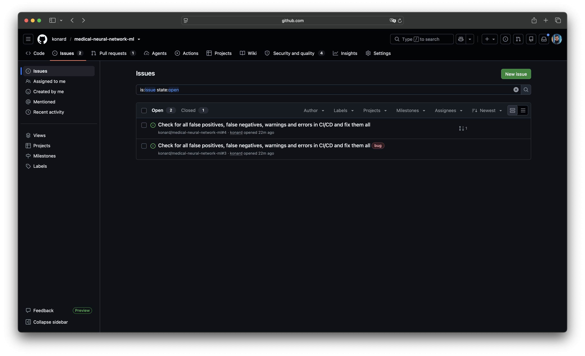
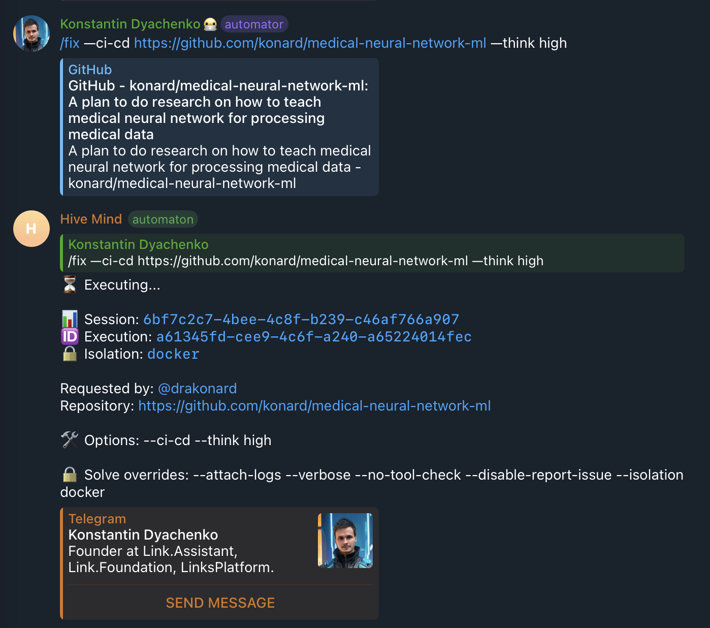

# Case study: `/fix --ci-cd` created the same issue twice (issue #3326)

- Issue: https://github.com/link-assistant/hive-mind/issues/3326
- Pull request: https://github.com/link-assistant/hive-mind/pull/3327
- Affected repository: [konard/medical-neural-network-ml](https://github.com/konard/medical-neural-network-ml) — issues [#3](https://github.com/konard/medical-neural-network-ml/issues/3) and [#4](https://github.com/konard/medical-neural-network-ml/issues/4)
- Hive Mind version at the time: `2.35.8` (Docker image `konard/hive-mind-dind:2.35.8`), `gh` 2.102.0

## Collected data

All files are in [`raw/`](./raw):

| File                                                                 | What it is                                                                                    |
| -------------------------------------------------------------------- | --------------------------------------------------------------------------------------------- |
| `screenshot-d0302758-…png`                                           | Issue list of the affected repository: two identical open issues, only #3 has the `bug` label |
| `screenshot-e116136e-…png`                                           | The Telegram `/fix --ci-cd … --think high` reply, showing only `⏳ Executing...`              |
| `solve-log-sanitized.log.txt`                                        | Log of the `/solve` run started by `/fix` (from the issue's first gist)                       |
| `telegram-bot.log.txt`                                               | Full bot log (from the issue's second gist)                                                   |
| `telegram-fix-session-excerpt.log.txt`                               | The `/fix` command and every bot log line for session `6bf7c2c7-…`                            |
| `issue-3.json`, `issue-4.json`, `issue-*-timeline.json`, `pr-5.json` | GitHub REST data of both issues and the resulting PR                                          |
| `repository-issue-types.json`                                        | GraphQL: owner type, `repository.issueTypes`, type/labels of #3 and #4                        |
| `default-branch-runs-at-incident.txt`                                | Final state of the two runs the issue body listed as `in_progress`                            |

## Screenshots

Two identical issues; only #3 got the `bug` label:



The Telegram reply stayed at "Executing..." for the whole session:



## Timeline (UTC, 2026-10-15)

| Time        | Event                                                                                                                                                                                                       | Source                                           |
| ----------- | ----------------------------------------------------------------------------------------------------------------------------------------------------------------------------------------------------------- | ------------------------------------------------ |
| 11:08:49    | Push `fd7703e` to `main` of the affected repository starts 5 workflows, among them `CI/CD Pipeline` and `Security`                                                                                          | `default-branch-runs-at-incident.txt`            |
| 11:09:41    | Telegram `/fix --ci-cd https://github.com/konard/medical-neural-network-ml --think high`; session `6bf7c2c7-4bee-4c8f-b239-c46af766a907` is launched with Docker isolation                                  | `telegram-fix-session-excerpt.log.txt`           |
| 11:09:46    | Reply edited to `⏳ Executing...` (execution `a61345fd-…`); it never changes again until completion                                                                                                         | same, screenshot                                 |
| ~11:10      | `fix.mjs` inspects the repository. The issue body lists `CI/CD Pipeline` and `Security` as `in_progress` and says "0 not passing"                                                                           | `issue-3.json`                                   |
| 11:10:11    | `gh issue create --type Bug --label bug` **creates #3** (GraphQL `createIssue` mutation, labels included)                                                                                                   | `issue-3.json`                                   |
| 11:10:11–13 | `gh` then resolves `--type Bug` against `repository.issueTypes`, which is `null` for a user-owned repository, and exits 1 with `type "Bug" not found; available types: ` **without printing the URL of #3** | `repository-issue-types.json`, gh source (below) |
| 11:10:13    | Label event `bug` on #3 (the label was part of the creation mutation)                                                                                                                                       | `issue-3-timeline.json`                          |
| 11:10:13    | hive-mind treats the exit code as "issue not created", logs "retrying without them" and runs `gh issue create` again without type/labels: **duplicate #4**                                                  | `issue-4.json`, pre-fix `createTaskIssue`        |
| 11:10:15    | `/solve https://github.com/konard/medical-neural-network-ml/issues/4 --development-log --deep-analysis --auto-merge …` starts                                                                               | `solve-log-sanitized.log.txt`                    |
| 11:10:17    | `Security` run on `main` completes with **failure**                                                                                                                                                         | `default-branch-runs-at-incident.txt`            |
| 11:10:30    | `CI/CD Pipeline` run on `main` completes with **failure**                                                                                                                                                   | same                                             |
| 11:11:09    | PR [#5](https://github.com/konard/medical-neural-network-ml/pull/5) opened for #4                                                                                                                           | `pr-5.json`                                      |
| 11:58:21    | PR #5 merged, #4 closed; #3 (the one with the `bug` label) stays open                                                                                                                                       | `pr-5.json`, `issue-4-timeline.json`             |
| 11:58:42    | Session completed with exit code 0                                                                                                                                                                          | `telegram-fix-session-excerpt.log.txt`           |

## Requirements from the issue

| #   | Requirement                                                                                           | Status in PR #3327                                                                                                                  |
| --- | ----------------------------------------------------------------------------------------------------- | ----------------------------------------------------------------------------------------------------------------------------------- |
| R1  | Never create duplicate issues in `/fix --ci-cd` (#3 "looks more correct": it has the label)           | Fixed: type preflight + idempotent recovery; tests                                                                                  |
| R2  | Wait for CI/CD on the default branch to finish before the task actually starts                        | Implemented: `waitForDefaultBranchCi` between issue creation and `/solve`                                                           |
| R3  | Still create the issue as soon as possible                                                            | Kept: the issue is created before the wait                                                                                          |
| R4  | Show a separate "waiting for CI/CD to finish" status in Telegram                                      | Implemented: `[HIVE-MIND FIX]` markers → session monitor edits the reply; en/ru/zh/hi                                               |
| R5  | Download all logs/data into `docs/case-studies/issue-3326`                                            | Done: `raw/`                                                                                                                        |
| R6  | Deep case study: timeline, requirements, root causes, solutions, existing components, online research | This document                                                                                                                       |
| R7  | Add debug/verbose output if data is insufficient                                                      | Done: `[issue-create]` and `[fix-ci-wait]` verbose lines, explicit warnings when the type is dropped or an existing issue is reused |
| R8  | Report issues to other projects with reproducible examples, workarounds and fix suggestions           | [cli/cli#14703](https://github.com/cli/cli/issues/14703)                                                                            |
| R9  | Fix the problem everywhere in the codebase                                                            | Done: all `createTaskIssue` callers; other `gh issue create` call sites audited (below)                                             |

## Root causes

### RC1 — `gh issue create --type` fails _after_ the issue already exists

Since cli/cli [#13057](https://github.com/cli/cli/pull/13057) (gh ≥ 2.9x), `--type` is applied in a second step. In [`pkg/cmd/issue/create/create.go`](https://github.com/cli/cli/blob/819f972eff771d5ec433c8d03c369cc43f1eab49/pkg/cmd/issue/create/create.go#L481-L496):

```go
newIssue, err = api.IssueCreate(apiClient, repo, params)   // the issue exists from here on
if err != nil {
    return
}

var updateOpts api.DeferredUpdateIssueOptions
updateOpts, err = deferredUpdateIssueOptions(apiClient, baseRepo, newIssue, opts) // resolves --type
if err != nil {
    return                                                   // URL of newIssue is never printed
}
```

`deferredUpdateIssueOptions` calls [`ResolveIssueTypeName`](https://github.com/cli/cli/blob/819f972eff771d5ec433c8d03c369cc43f1eab49/pkg/cmd/issue/shared/lookup.go#L233-L248), which returns `type "Bug" not found; available types: ` when the repository has no such type. Issue types exist only for organization-owned repositories; for `konard/medical-neural-network-ml` (owner `__typename: "User"`) GraphQL returns `issueTypes: null` (`raw/repository-issue-types.json`). So on every user-owned repository `gh issue create --type X` creates the issue and then exits 1 without printing its URL.

gh's own unit test [`create with type not found`](https://github.com/cli/cli/blob/819f972eff771d5ec433c8d03c369cc43f1eab49/pkg/cmd/issue/create/create_test.go#L908-L940) stubs the `IssueCreate` mutation and expects the error — i.e. it pins the "issue created, command failed" behaviour.

### RC2 — hive-mind assumed "non-zero exit code ⇒ no issue was created"

The pre-fix `createTaskIssue` (`src/task.issue-creation.lib.mjs`):

```js
const result = await run('gh', buildCreateIssueArgs({ repository, title: sanitizedTitle, bodyFile, issueType, labels }));
if (result.code === 0) return parseCreatedTaskIssueOutput(result.stdout);
...
await log?.(`⚠️  Could not create issue with type/labels (...); retrying without them`);
const retry = await run('gh', buildCreateIssueArgs({ repository, title: sanitizedTitle, bodyFile }));
```

`issue create` is not idempotent, so a blind retry duplicates whenever the first attempt failed after the mutation. The retry dropped the labels as well, which is why the surviving issue (#4) lacked `bug` and #3 "looks more correct". The `/solve` run then worked on #4.

### RC3 — `/fix` started `/solve` while the default branch CI was still running

`fix.mjs` built the issue body from a snapshot in which `CI/CD Pipeline` and `Security` were `in_progress` ("0 not passing"), and started `/solve` two seconds after creating the issue. Both runs failed 4–17 seconds later. The solver therefore started with a stale, too-optimistic picture, and the default branch it branched from was still being validated.

### RC4 — Telegram only knew "Executing..."

The bot's reply is derived from the isolation session state, which is `executing` for the whole `/fix` process. `fix.mjs` had no way to report its own phases (issue created / waiting for CI / solving).

## Solutions implemented

### S1 — Never duplicate issues (RC1, RC2)

`src/task.issue-creation.lib.mjs`:

1. **Type preflight** (`getRepositoryIssueTypes`, `resolveSupportedIssueType`): one GraphQL query for `repository.issueTypes`. When the repository has no types (`null`, user-owned) or not the requested one, `--type` is dropped _before_ creating the issue and `⚠️  Creating issue without type: …` is logged; a case-insensitive match is replaced by the canonical name. When support cannot be determined, the type is kept (old behaviour) and step 2 protects against duplicates.
2. **Idempotent recovery** (`findRecentlyCreatedIssue`): if `gh issue create` fails, the newest issues of the repository are searched for one with the exact title and body created since the attempt started (with clock-skew tolerance). If found, it is returned (`…but the issue was created: <url>; not retrying to avoid a duplicate`) instead of retrying.
3. Only when no such issue exists does the old "retry without metadata" fallback run.

Because all callers (`/fix --ci-cd`, `/fix --update-all-dependencies`, `/task`, `/solve` repository mode) go through `createTaskIssue`, the fix applies everywhere. Other `gh issue create` call sites were audited: `src/github-error-reporter.lib.mjs` and `src/youtrack/youtrack-sync.mjs` use `--label` only (resolved _before_ the mutation, so a failure means nothing was created) and `src/task.mjs` uses neither.

### S2 — Wait for default-branch CI/CD before `/solve` (RC3)

`src/fix.ci-wait.lib.mjs` + `src/fix.mjs`:

- The issue is created first (R3); then `/fix` polls `repos/{repo}/actions/runs?branch=<default>` every 30 s until no run of an active workflow is `queued`/`in_progress`/`waiting`/`requested`/`pending`.
- Bounded by `--ci-wait-timeout <minutes>` (default 60); `--no-wait-for-ci` skips it; `--no-solve` never waits. Three consecutive failed polls end the wait as `unknown` — the task still starts.
- When runs finished (or were still running at the timeout), their latest results are posted as an issue comment, so the solver does not rely on the stale `in_progress` rows of the issue body.

### S3 — Separate Telegram status (RC4)

`fix.mjs` prints one machine-readable line per phase/poll: `[HIVE-MIND FIX] {"phase":"waiting-for-ci","pending":[…],"waitedMs":…,"issueUrl":…}`. `src/fix-progress.lib.mjs` (`reportFixProgress`) is called by the session monitor for running `/fix` sessions, reads a bounded 32 KB log tail, and edits the reply, e.g.:

```
⏳ Waiting for CI/CD on `main` to finish before starting the task...
🔄 Running: `CI/CD Pipeline` (in_progress), `Release` (queued)
⏱ Waited 3m 30s of 1h 0m
📝 Issue: https://github.com/owner/repo/issues/3
```

followed by ``✅ CI/CD on `main` finished (10m 30s)`` and, once `/solve` starts, `⏳ Executing...` together with the CI outcome (output of `experiments/issue-3326-fix-progress-preview.mjs`). Updates are deduplicated, best effort, stop after the `solving` phase, and the issue link is kept in the completion message. Strings are localized (en/ru/zh/hi).

### Tests

- `tests/test-fix-ci-cd.mjs` — `issue #3326:` cases: a fake `gh` that creates the issue and _then_ fails on an unknown type (exactly gh 2.102.0's behaviour) proves that exactly one issue is created; preflight drops/canonicalizes types; lookup ignores PRs, old and different issues. These tests fail on the pre-fix implementation.
- `tests/test-fix-ci-wait-3326.mjs` — argument parsing/validation, `waitForDefaultBranchCi` (idle / finished / timeout / unknown with fake clock), the result comment, marker parsing, Telegram formatting (incl. `ru`), `reportFixProgress` (edits, dedupe, done, failures), and the session-monitor/`fix.mjs` wiring.
- `experiments/issue-3326-issue-type-preflight.mjs` — live check of the preflight against real repositories (`konard/medical-neural-network-ml` → `[]`, type dropped; `link-assistant/hive-mind` → `Task, Bug, Feature`, `bug` → `Bug`).

## Alternatives considered / existing components

| Option                                                                                                                                                                      | Notes                                                                                                                                                                                                      |
| --------------------------------------------------------------------------------------------------------------------------------------------------------------------------- | ---------------------------------------------------------------------------------------------------------------------------------------------------------------------------------------------------------- |
| REST `POST /repos/{owner}/{repo}/issues` with `type` ([docs](https://docs.github.com/en/rest/issues/issues#create-an-issue)) or GraphQL `createIssue(input: {issueTypeId})` | Single request, so no "created but failed" state. Rejected for now: replaces the `gh issue create` path shared with templates/sanitization and still needs the type preflight for user-owned repositories. |
| Only labels, never `--type`                                                                                                                                                 | Simplest, but loses the issue type on organization repositories, where it is used (e.g. `isBugIssueType` in the development log).                                                                          |
| Wait for the `cli/cli` fix                                                                                                                                                  | [#13899](https://github.com/cli/cli/pull/13899) turns _mutation_ failures into warnings but deliberately keeps `type "X" not found` fatal, so this incident would still happen.                            |
| `gh run watch` / `gh run list --branch main --status in_progress`                                                                                                           | `gh run watch` follows a single run interactively; polling the runs list (what we do via `gh api`) covers all workflows of the branch and is testable.                                                     |
| Marketplace actions such as [workflow-wait-action](https://github.com/ygqygq2/workflow-wait-action), [await-workflow](https://github.com/johannesvedder/await-workflow)     | Same polling idea, but they run _inside_ GitHub Actions; `/fix` runs outside, so the logic lives in hive-mind.                                                                                             |
| `workflow_run` trigger                                                                                                                                                      | Fires per completed workflow and only from the default branch's workflow files; not applicable to an external process.                                                                                     |

Known limitations:

- Progress is read from the isolation log (`statusResult.logPath`); sessions without an isolation log keep the old "Executing..." text (the wait itself still happens).
- The recovery lookup reads the newest 30 issues; on a repository receiving many issues per second the created issue could be pushed out before the lookup — then the old retry runs, as before.

## Upstream report

`cli/cli` already tracks the _permission_ variant of this pattern in [#13804](https://github.com/cli/cli/issues/13804) (fix PR [#13899](https://github.com/cli/cli/pull/13899)) and the `--assignee` variant in [#14367](https://github.com/cli/cli/issues/14367). The `type "X" not found` variant, which hit us, is explicitly excluded from #13899 on the assumption that it "runs before any mutation" — the source above shows it runs after. It is reported separately, with a reproduction, workaround and suggested fix, as [cli/cli#14703](https://github.com/cli/cli/issues/14703).

## References

- gh source at [`819f972`](https://github.com/cli/cli/tree/819f972eff771d5ec433c8d03c369cc43f1eab49): `pkg/cmd/issue/create/create.go` L481–L496, L512–L526; `pkg/cmd/issue/shared/lookup.go` L233–L248; `pkg/cmd/issue/create/create_test.go` L908–L940
- [cli/cli#13057](https://github.com/cli/cli/pull/13057) — added `--type` with deferred updates
- [cli/cli#12110](https://github.com/cli/cli/issues/12110) — feature request for `--type`
- [GitHub Docs: Managing issue types in an organization](https://docs.github.com/en/issues/tracking-your-work-with-issues/configuring-issues/managing-issue-types-in-an-organization)
