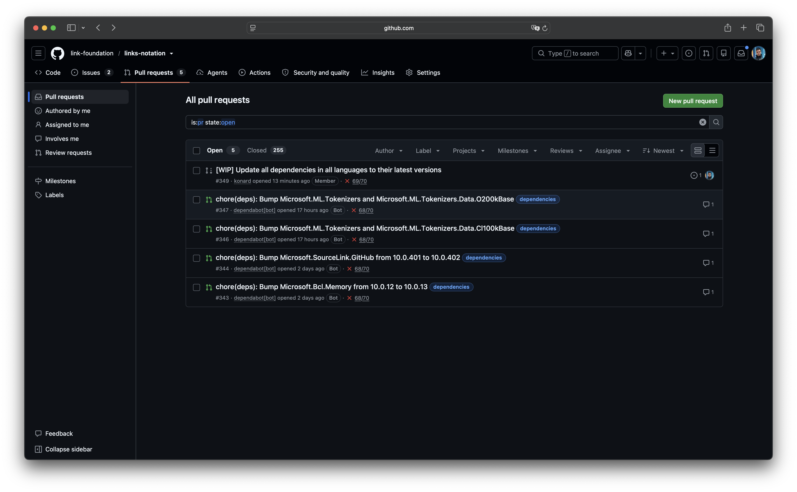

# Case study: `/fix --update-all-dependencies` left the Dependabot pull requests open (issue #3413)

Issue: [link-assistant/hive-mind#3413](https://github.com/link-assistant/hive-mind/issues/3413). The requested behavior: by default, `--update-all-dependencies` merges every Dependabot pull request without waiting for CI/CD, does this before the issue is created, and adds a note to the created issue asking the solver to fix every error those pull requests introduce.

Examples given in the issue: [link-foundation/links-notation#348](https://github.com/link-foundation/links-notation/issues/348) (the generated issue) and [#349](https://github.com/link-foundation/links-notation/pull/349) (the solver's pull request).

## Collected data

Everything is in [`raw/`](raw/):

| File                                                                                | Content                                                                                            |
| ----------------------------------------------------------------------------------- | -------------------------------------------------------------------------------------------------- |
| `screenshot-764a5cb3-dependabot-prs-left-open.png`                                  | Screenshot attached to the issue                                                                   |
| `issue-348.json`, `issue-348-timeline.json`, `issue-348-comments.json`              | The issue generated by `/fix --update-all-dependencies`                                            |
| `pr-349.json`, `pr-349-comments.json`                                               | The solver's pull request                                                                          |
| `dependabot-prs.json`                                                               | Every Dependabot pull request of links-notation (`gh pr list --author app/dependabot --state all`) |
| `pr-{343,344,346,347}.json`, `pr-*-timeline.json`, `pr-*-comments.json`             | The four Dependabot pull requests that were open when #348 was created                             |
| `run-38532262437-auto-merge.log`                                                    | `auto-merge` job of PR #343                                                                        |
| `run-38532262422-dependency-freshness.log`                                          | `dependency freshness / latest-stable` job of PR #343                                              |
| `AutoMerge.yml`, `dependabot.yml`                                                   | The target repository's Dependabot workflow and configuration                                      |
| `repository-merge-settings.json`, `branch-protection.json`, `ruleset-24860631.json` | Merge settings and branch rules of `main`                                                          |

[`raw/dry-run-router.log`](raw/dry-run-router.log) is a `fix link-assistant/router --update-all-dependencies --dry-run` run with the new code against a real repository that had five open Dependabot pull requests.

## Screenshot

## Timeline (UTC)

| Time                   | Event                                                                                                                                                                                   |
| ---------------------- | --------------------------------------------------------------------------------------------------------------------------------------------------------------------------------------- |
| up to 2026-10          | Dependabot pull requests #277–#338 merge within seconds of being opened, while the repository's auto-merge still worked                                                                 |
| 2026-10-14 08:01       | Dependabot opens #343 (Microsoft.Bcl.Memory 10.0.12 → 10.0.13) and #344 (Microsoft.SourceLink.GitHub 10.0.401 → 10.0.402). Both get "The following labels could not be found: `csharp`" |
| 2026-10-14 08:01:51    | `auto-merge` on #343 fails: `GraphQL: Auto merge is not allowed for this repository (enablePullRequestAutoMerge)` (`HAS_PAT: false`)                                                    |
| 2026-10-14 08:01:56    | `dependency freshness / latest-stable` on #343 fails: `syn`, `Microsoft.SourceLink.GitHub`, `central-publishing-maven-plugin` and `phpunit` reported OUTDATED, none touched by #343     |
| 2026-10-15 22:45       | Dependabot opens #346 and #347 (Microsoft.ML.Tokenizers groups); #345 is opened and closed 18 s later                                                                                   |
| —                      | Each of #343, #344, #346 and #347: 70 checks, 68 passing, the same 2 failing. Nobody merges them                                                                                        |
| 2026-10-16 16:02:38    | `/fix --update-all-dependencies` creates #348. The issue body does not mention the four open Dependabot pull requests                                                                   |
| 2026-10-16 16:03:37    | The solver opens #349 and updates every dependency by hand, including the four that Dependabot had already prepared                                                                     |
| 2026-10-16 19:28:13    | #349 is merged; #348 is closed                                                                                                                                                          |
| 2026-10-16 19:31–19:32 | Dependabot closes #343, #344, #346 and #347: "no longer a dependency" / "no longer updatable, so this is no longer needed". None of them was ever merged                                |

## Requirements from the issue

| #   | Requirement                                                                                               | Status                                                                                                                                                                                                                       |
| --- | --------------------------------------------------------------------------------------------------------- | ---------------------------------------------------------------------------------------------------------------------------------------------------------------------------------------------------------------------------- |
| R1  | `--update-all-dependencies` merges all Dependabot pull requests **by default**, without waiting for CI/CD | Done. `mergeDependabotPullRequests` in `src/fix.dependabot-merge.lib.mjs` is on by default; it never polls CI/CD and never uses `--auto`                                                                                     |
| R2  | The merge happens **before** the issue is created                                                         | Done. `prepareUpdateDependenciesIssue` merges first, then reads the default branch, its latest commit and its file tree, so the issue describes the repository after the merges                                              |
| R3  | The created issue says to fix every error related to these pull requests                                  | Done. The issue opens with a "Dependabot pull requests merged before this issue was created" section: each pull request, its non-passing checks with links, and a bold "Fix every error these merges introduced" instruction |
| R4  | Case study with logs, timeline, requirements, root causes, solutions and existing components              | This document and `raw/`                                                                                                                                                                                                     |
| R5  | Add debug output where data is missing                                                                    | Each pull request's outcome and CI state is logged; `--verbose` also logs the raw `gh pr merge` errors before the `--admin` retry                                                                                            |
| R6  | Report issues to other repositories                                                                       | [link-foundation/links-notation#350](https://github.com/link-foundation/links-notation/issues/350)                                                                                                                           |
| R7  | Apply the change everywhere `--update-all-dependencies` creates an issue                                  | `/fix` (CLI and Telegram) and Telegram `/task --update-all-dependencies` share `prepareUpdateDependenciesIssue`; both accept `--no-merge-dependabot-prs`                                                                     |

## Root causes

### RC1: `/fix --update-all-dependencies` ignored open Dependabot pull requests

The flow was: detect languages, list files, build the issue, create it, and solve. Nothing asked GitHub about open pull requests. The issue never mentioned them, so the solver redid their updates by hand. After the solver's pull request merged, Dependabot saw its updates were already applied and closed its pull requests. Dependabot's work was thrown away, and its checks were never run against the combined change.

### RC2: The target repository's Dependabot pull requests could never merge themselves

This is upstream and reported as [links-notation#350](https://github.com/link-foundation/links-notation/issues/350).

- `AutoMerge.yml` takes the `gh pr merge --auto` path because the `DEPENDABOT_AUTO_MERGE_TOKEN` secret is not configured (`HAS_PAT: false`). The repository has `allow_auto_merge: false`, so GitHub rejects the call (`raw/run-38532262437-auto-merge.log`). [#133](https://github.com/link-foundation/links-notation/issues/133) reported the same symptom in 2025.
- `scripts/ci/check-dependencies.py` (the `latest-stable` job) checks the whole repository for outdated dependencies. A pull request that bumps one package therefore fails as long as any other package is outdated. With several Dependabot pull requests open at once, every one of them fails (`raw/run-38532262422-dependency-freshness.log`).
- `.github/dependabot.yml` asks for a `csharp` label that does not exist.

### RC3: The branch rules were not the blocker

`main` has no classic branch protection (`raw/branch-protection.json`). It is gated by ruleset 24860631, which requires the seven language checks (JavaScript, Rust, Python, Java, Go, CSharp, PHP) on the same, up-to-date commit, has no bypass actors and has `current_user_can_bypass: never` (`raw/ruleset-24860631.json`). All seven passed on every Dependabot pull request. A plain `gh pr merge --merge` would have succeeded on any pull request whose branch was up to date. The failing checks were not required ones, so the pull requests were mergeable. Only the auto-merge mechanism was broken.

## Solution implemented

### S1: Merge before preparing the issue (RC1, R1, R2, R7)

`src/fix.dependabot-merge.lib.mjs` does the merging:

1. **List.** `gh pr list --repo R --author app/dependabot --state open --limit 100 --json number,title,url,author,baseRefName,headRefName,headRefOid,isDraft,mergeable,statusCheckRollup`. The author is re-checked locally (`app/dependabot`, `dependabot[bot]`). The list is sorted oldest first, the order in which Dependabot opened the pull requests.
2. **Summarize CI/CD at merge time** (`summarizeChecks`). Only the latest attempt of each check counts.
   - Failing: `FAILURE`, `ERROR`, `TIMED_OUT`, `CANCELLED`, `ACTION_REQUIRED`, `STARTUP_FAILURE`, `STALE`.
   - Pending: anything not `COMPLETED`.
   - The summary is only recorded for the issue. Nothing waits on it.
3. **Pick the merge method** the repository allows: merge commit, then squash, then rebase (`gh api repos/R`).
4. **Merge.** `gh pr merge N --repo R --<method> --match-head-commit <headRefOid>`. `--match-head-commit` makes sure the commit that was inspected is the one that gets merged.
   - If only branch rules block the merge (required checks, reviews, or an out-of-date branch in strict mode), the merge is retried once with `--admin`. Going past those rules is what "without waiting for CI/CD" means.
   - Conflicts are not retried, because `--admin` cannot fix them.
   - Drafts and `CONFLICTING` pull requests are skipped.
5. **Never fail the run.** A listing error or a failed merge is recorded and reported in the issue. The issue is still created.

`prepareUpdateDependenciesIssue` calls this first, before it reads the default branch. `/fix` (`src/fix.mjs`), Telegram `/fix` and Telegram `/task --update-all-dependencies` all go through it.

How the flags behave:

- `--dry-run` only lists what would be merged.
- `--no-merge-dependabot-prs` turns the step off.
- The flag is owned by `/fix` and is not forwarded to `/solve`. It is accepted by Telegram `/fix` (`FIX_OWN_OPTIONS`) and by `/task` (`resolveMergeDependabotPrs`).

The existing default-branch CI wait from [#3326](../issue-3326/README.md) now also covers the runs these merges trigger. `/solve` starts only after the post-merge default-branch CI/CD has finished, and its results are posted to the issue. The solver starts from real failure data.

### S2: Ask the solver to fix what the merges broke (R3)

`buildDependabotPullRequestsSection` renders the first section of the issue body:

- **Merged pull requests.** Each one is listed with a link, its base branch and its non-passing checks (linked to the job), and marked when `--admin` was used. Below the list is the bold instruction:

  > **Fix every error these merges introduced.** Their CI/CD was not waited for, and the checks listed above were not passing at merge time. Look at the CI/CD runs of the default branch after these merges, reproduce each failing build, test, lint, type-check, security or deprecation error they caused, and fix all of them as part of this issue. Do not revert a merged update to make a check pass — adapt the code, the configuration or the workflow instead. The work is not done until CI/CD of the default branch is green again.

- **Pull requests left open.** Each one is listed with its reason. The solver is asked to apply those updates in its own pull request, and to fix what made them unmergeable (a failing check, a conflict, or a repository setting such as disabled auto-merge). Dependabot closes them once the update lands.
- **Listing error.** If the pull requests could not be listed, the section says so and asks for them to be handled by hand.

The section is omitted when nothing was open or the step was disabled.

### Tests

`tests/fix-dependabot-merge-3413.test.mjs` contains 14 tests. Its fixtures are copied from links-notation #343–#347. It covers:

- author filtering
- check summaries, including re-runs and `StatusContext`
- choice of merge method
- `gh pr merge` argv
- oldest-first merging with no CI polling and no `--auto`
- the `--admin` retry, and skipped conflicts and drafts
- dry run
- a listing failure
- no section when nothing is open
- merge-before-issue ordering in `createUpdateDependenciesIssue`
- the issue body note
- the opt-out
- `/fix` argument parsing and Telegram `/fix` and `/task` option handling

`raw/dry-run-router.log` shows the new code against [link-assistant/router](https://github.com/link-assistant/router) in dry-run mode. All five open Dependabot pull requests are listed, with their real failing checks (`Changelog Fragment Check`, `Dependency Audit`, `Lint and Format Check`) in the issue note.

## Alternatives considered / existing components

| Option                                                                                                                                                                                                                                                                                                                              | Why it was not used as the fix                                                                                                                                                                                          |
| ----------------------------------------------------------------------------------------------------------------------------------------------------------------------------------------------------------------------------------------------------------------------------------------------------------------------------------- | ----------------------------------------------------------------------------------------------------------------------------------------------------------------------------------------------------------------------- |
| GitHub native auto-merge (`gh pr merge --auto`), the pattern in GitHub's [Automating Dependabot with GitHub Actions](https://docs.github.com/en/code-security/dependabot/working-with-dependabot/automating-dependabot-with-github-actions) guide, with [`dependabot/fetch-metadata`](https://github.com/dependabot/fetch-metadata) | It waits for the required checks, which the issue explicitly rejects. It also needs `allow_auto_merge`, which was off in links-notation, and it would never merge while a check fails                                   |
| Renovate's [`automerge` + `ignoreTests`](https://docs.renovatebot.com/key-concepts/automerge/)                                                                                                                                                                                                                                      | Closest to the requested behavior ("ignore all status checks"), but it means replacing Dependabot in every target repository. Hive-mind has to work with whatever bot the repository already uses                       |
| Mergify / Kodiak merge queues                                                                                                                                                                                                                                                                                                       | Need an app installed in the target repository, and they also wait for checks                                                                                                                                           |
| Reusing `mergePullRequest` from `src/github-merge.lib.mjs`                                                                                                                                                                                                                                                                          | It enforces hive-mind's own issue-closing checks (#2335/#2406) for solver pull requests. These do not apply to Dependabot pull requests                                                                                 |
| Let `/solve` merge the Dependabot pull requests                                                                                                                                                                                                                                                                                     | The issue requires the merge to happen before the issue is created. Merging in `/fix` also means the issue body and the CI wait already reflect the merged state                                                        |
| `@dependabot rebase` before merging, so later pull requests are not out of date                                                                                                                                                                                                                                                     | Asynchronous and slow (Dependabot may take minutes), which conflicts with "without waiting". A pull request that conflicts after earlier merges is listed in the issue instead, and its update is applied by the solver |
| Merge with `--auto` first and fall back to direct merge                                                                                                                                                                                                                                                                             | Leaves pull requests in a queued state that the issue cannot describe precisely                                                                                                                                         |

The [`gh pr merge` manual](https://cli.github.com/manual/gh_pr_merge) documents both flags used here. `--admin` merges "a pull request that does not meet requirements". `--match-head-commit` gives the "commit SHA that the pull request head must match to allow merge".

## Known limits

- `--admin` cannot bypass a ruleset with no bypass actors (`current_user_can_bypass: never`, as in links-notation). If such a ruleset's required checks fail, the pull request stays open and is listed in the issue.
- With a strict "branch must be up to date" rule, merging the first pull request makes the others out of date. Each later merge is then retried with `--admin`. If that is not allowed, those pull requests stay open and are listed.
- Only pull requests authored by Dependabot are merged. Renovate and other bots are untouched.

## Upstream report

- [link-foundation/links-notation#350](https://github.com/link-foundation/links-notation/issues/350): auto-merge is disallowed (`allow_auto_merge: false`, no PAT), the repository-wide freshness check fails every single-package bump, and the `csharp` label is missing. It includes logs, a reproduction and fix options.

## References

- Issue [#3413](https://github.com/link-assistant/hive-mind/issues/3413), pull request [#3414](https://github.com/link-assistant/hive-mind/pull/3414)
- [links-notation#348](https://github.com/link-foundation/links-notation/issues/348), [#349](https://github.com/link-foundation/links-notation/pull/349), [#343](https://github.com/link-foundation/links-notation/pull/343), [#344](https://github.com/link-foundation/links-notation/pull/344), [#346](https://github.com/link-foundation/links-notation/pull/346), [#347](https://github.com/link-foundation/links-notation/pull/347), [#133](https://github.com/link-foundation/links-notation/issues/133)
- Related case study: [issue #3326](../issue-3326/README.md) (wait for default-branch CI/CD before `/solve`)
- [GitHub: Automating Dependabot with GitHub Actions](https://docs.github.com/en/code-security/dependabot/working-with-dependabot/automating-dependabot-with-github-actions)
- [GitHub CLI manual: `gh pr merge`](https://cli.github.com/manual/gh_pr_merge)
- [Renovate: Automerge configuration and troubleshooting](https://docs.renovatebot.com/key-concepts/automerge/)
