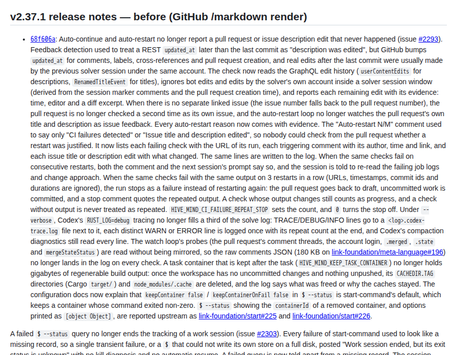
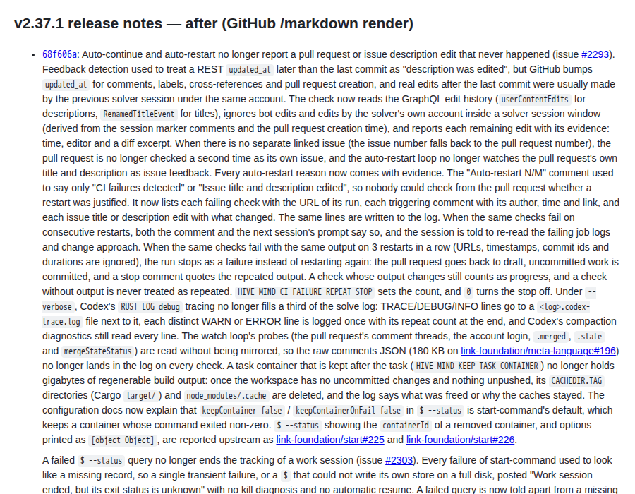

# Case Study: Broken Bullet List in the v2.37.1 Release Notes (Issue #3445)

## Summary

The [v2.37.1 release notes](https://github.com/link-assistant/hive-mind/releases/tag/v2.37.1)
showed one bullet followed by 19 loose paragraphs. In `CHANGELOG.md` the same
text is one list item with 19 paragraphs. The release formatter
(`scripts/format-release-notes.mjs`) called `.trim()` on every line. That
removed the two-space indentation Changesets uses for later paragraphs of a
changeset, and those paragraphs fell out of the list item.

An audit of all 893 GitHub releases against `CHANGELOG.md` found the same bug in
302 releases (v0.38.9 through v2.37.1). It also found five more defect classes
in the same pipeline:

- text cut at `---`;
- the `- <hash>:` marker of the first item dropped;
- a literal `\n` turned into a line break;
- trailing quotes stripped;
- Minor and Major releases never formatted at all.

The publication sanitizer also masked option names and code in the v2.33.5 and
v2.33.6 notes.

This pull request:

- fixes the formatter, the CHANGELOG extraction, the manual-release CHANGELOG
  writer and the sanitizer false positives;
- adds regression tests;
- adds a repair script, which rebuilt all 367 damaged releases from
  `CHANGELOG.md` (the 366 the audit found, plus v2.38.0, which was published
  during this work);
- reports the bug upstream, to the template every copy of the formatter came
  from.

## Data in this folder

| Path                                      | Content                                                                                     |
| ----------------------------------------- | ------------------------------------------------------------------------------------------- |
| `data/release-v2.37.1.json`               | The broken v2.37.1 release as published (GitHub API)                                        |
| `data/all-releases.json`                  | Backup of `id`, `tag_name`, `published_at` and `body` of all 893 releases before the repair |
| `data/audit-before.tsv`                   | Per-release audit result before the repair (`experiments/issue-3445-audit-releases.mjs`)    |
| `data/audit-before-summary.json`          | Totals of that audit                                                                        |
| `data/missing-text-causes.txt`            | Why text is missing, per release (`experiments/issue-3445-classify-missing-text.mjs`)       |
| `data/audit-after.tsv`, `-summary`        | The same audit on the live releases after the repair                                        |
| `render/v2.37.1-before.html`              | GitHub's own render (`POST /markdown`, `gfm` mode) of the published body                    |
| `render/v2.37.1-after.html`               | GitHub's render of the repaired body                                                        |
| `render/v2.37.1-before.png`, `-after.png` | Screenshots of those two renders                                                            |
| `data/release-v2.38.0-before.md`          | v2.38.0 as published with the old formatter during this work, before its repair             |
| `repair/dry-run.log`                      | `scripts/repair-release-notes.mjs` dry run against the backup                               |
| `repair/apply.log`                        | The `--apply` run that repaired the releases                                                |
| `repair/verify-dry-run.log`               | A second dry run against the live releases after the repair (nothing left to repair)        |

## Timeline

| Date (UTC)       | Event                                                                                                                                                                                                                                                                                                                                                  |
| ---------------- | ------------------------------------------------------------------------------------------------------------------------------------------------------------------------------------------------------------------------------------------------------------------------------------------------------------------------------------------------------ |
| 2025-09-14       | First GitHub release (v0.0.5). Releases before v0.38.9 have no section in the current `CHANGELOG.md` (302 releases).                                                                                                                                                                                                                                   |
| 2025-12-13       | `24488c3c0` adds `scripts/validate-changeset.mjs`, which requires exactly one changeset per pull request.                                                                                                                                                                                                                                              |
| 2025-12-14       | `40545f672` ("consolidate CI/CD to single release.yml following template best practices") copies `format-release-notes.mjs` from [js-ai-driven-development-pipeline-template](https://github.com/link-foundation/js-ai-driven-development-pipeline-template). It already has `.map(line => line.trim())`, the `---` truncation and a Patch-only regex. |
| 2025-12-14 17:06 | v0.38.9 is the first formatted release, and already has lost indentation plus a dropped `- <hash>:` marker.                                                                                                                                                                                                                                            |
| 2025-12-15       | v0.39.0 is the first unformatted Minor release: the Patch-only regex finds nothing and the body stays raw (37 releases until v2.0.0).                                                                                                                                                                                                                  |
| 2026-02-13       | `03549ca08` (issue #1271) looks up every PR and adds Minor support. It keeps the trimming. Major (v2.0.0 on 2026-06-16) is still unformatted.                                                                                                                                                                                                          |
| 2026-03-20       | `0cfcb6a6b` (issue #1452) keeps changesets as separate files, so several PRs in one release become several list items.                                                                                                                                                                                                                                 |
| 2026-07-27       | `cc1a6d9f6` routes release bodies through `sanitizeForPublication`.                                                                                                                                                                                                                                                                                    |
| 2026-10-01       | v2.33.5 and v2.33.6 are published with `…Tokens: [REDACTED]` and `token => [REDACTED]`, which were code in the changeset and not credentials.                                                                                                                                                                                                          |
| 2026-10-16 18:53 | PR #3390 is merged with one changeset of 19 paragraphs (the one-changeset rule makes a multi-change PR one list item).                                                                                                                                                                                                                                 |
| 2026-10-16 19:29 | v2.37.1 is published. The formatter trims every line, so GitHub renders one bullet followed by 19 paragraphs.                                                                                                                                                                                                                                          |
| 2026-10-17 08:33 | Issue #3445 is opened.                                                                                                                                                                                                                                                                                                                                 |
| 2026-10-17       | This pull request: fix, tests, audit, repair of the published releases, and upstream issue [link-foundation/js-ai-driven-development-pipeline-template#236](https://github.com/link-foundation/js-ai-driven-development-pipeline-template/issues/236).                                                                                                 |

## Requirements from the issue

| #   | Requirement                                                                  | Where it is addressed                                                                                                                         |
| --- | ---------------------------------------------------------------------------- | --------------------------------------------------------------------------------------------------------------------------------------------- |
| R1  | Find the root cause of the broken bullet list in v2.37.1                     | [Root causes](#root-causes), RC1                                                                                                              |
| R2  | Fix it so release notes are always nicely formatted                          | `scripts/format-release-notes.lib.mjs`, `format-release-notes.mjs`, `create-github-release.mjs`, `instant-version-bump.mjs`, sanitizer; tests |
| R3  | Check previous releases for similar issues and investigate every failed case | [Audit of all releases](#audit-of-all-releases), `data/audit-before.tsv`, `data/missing-text-causes.txt`                                      |
| R4  | Download all logs and data into `docs/case-studies/issue-3445`               | `data/`, `render/`, `repair/`                                                                                                                 |
| R5  | Deep case study: timeline, requirements, root causes, solutions and plans    | This document                                                                                                                                 |
| R6  | Search online, and check existing components or libraries                    | [Existing tools and research](#existing-tools-and-research)                                                                                   |
| R7  | Add debug output or a verbose mode where data is missing                     | `--verbose` / `VERBOSE` in `format-release-notes.mjs` and `repair-release-notes.mjs`; dry run by default                                      |
| R8  | Report the problem to other affected repositories                            | [Upstream report](#upstream-report)                                                                                                           |
| R9  | Apply the fix everywhere in the codebase                                     | [Fix everywhere](#fix-everywhere-in-this-repository)                                                                                          |
| R10 | Do everything in one pull request                                            | PR #3446                                                                                                                                      |

## How Changesets writes a multi-paragraph changeset

The CHANGELOG is written by `@changesets/cli/changelog`, which is
`@changesets/changelog-git` (`.changeset/config.json`). Its `getReleaseLine` is
(`node_modules/@changesets/changelog-git/dist/index.mjs`):

```js
const [firstLine, ...futureLines] = changeset.summary.split('\n').map(l => l.trimEnd());
let returnVal = `- ${changeset.commit ? `${changeset.commit.slice(0, 7)}: ` : ''}${firstLine}`;
if (futureLines.length > 0) returnVal += `\n${futureLines.map(l => `  ${l}`).join('\n')}`;
```

So a changeset becomes **one** list item, and every later line is indented by
two spaces. CommonMark keeps a later block inside the list item only when it is
indented to the item's content column, which is two columns for `- `
([CommonMark 0.31.2, §5.2 List items](https://spec.commonmark.org/0.31.2/#list-items):
"indenting subsequent lines of Ls by W + N spaces, is a list item with Bs as its
contents"). Remove the indentation and the paragraph ends the list.

`changesets/action` creates GitHub releases by copying the `CHANGELOG.md`
section unchanged (`createRelease` in
[`src/run.ts`](https://github.com/changesets/action/blob/main/src/run.ts) uses
`body: changelogEntry.content`). The structure is only lost because this
repository rewrites the body afterwards.

## Root causes

### RC1 – every line was trimmed (lost indentation, 302 releases, including v2.37.1)

`format-release-notes.mjs` cleaned the description with:

```js
.split('\n')
.map(line => line.trim()) // Trim whitespace from each line
.join('\n')
```

The comment describes the intent ("normalize whitespace"), but for Markdown the
leading whitespace is structure. Each continuation paragraph and nested list
item lost its two spaces. GitHub then closed the list after the first paragraph,
which is exactly what v2.37.1 shows (`render/v2.37.1-before.html`):

| Render of v2.37.1          | Before | After |
| -------------------------- | ------ | ----- |
| `<li>` elements            | 1      | 1     |
| `<p>` inside the list item | 0      | 19    |
| `<p>` after the list       | 20     | 2     |

(The two paragraphs after the list in the repaired body are the
`**Related Pull Request:** #3390` line and the npm badge, as before.)

Why it became visible now: `validate-changeset.mjs` allows exactly one
changeset per PR. PR #3390 shipped many changes, so its changeset had 19
paragraphs. Earlier releases had the same bug, but with one or two paragraphs it
was easy to miss.

### RC2 – text was dropped (102 releases)

`data/missing-text-causes.txt` classifies every release whose body misses words
of its `CHANGELOG.md` section:

| Cause                                                                                                                                              | Releases | Examples                          |
| -------------------------------------------------------------------------------------------------------------------------------------------------- | -------- | --------------------------------- |
| The regex `/### Patch Changes\s*\n\s*-\s+([a-f0-9]+):\s+(.+?)$/s` consumed the first `- <hash>:` (used before #1271)                               | 89       | v1.21.3, v1.17.2, v1.0.1          |
| `CHANGELOG.md` has more list items than the release, e.g. two `## 1.48.1` version commits (`977129778`, `8ae1de446`) later merged into one section | 37       | v1.48.1, v1.46.8, v1.21.2         |
| Only one `### … Changes` section was kept: the Patch-only regex dropped the `### Minor Changes` section above it                                   | 4        | v0.44.0, v0.46.0, v0.48.0, v1.4.0 |
| Trailing quotes were stripped by `.replace(/(['"])+$/g, '')`                                                                                       | 3        | v1.20.1, v1.38.3, v1.49.3         |
| A literal `\n` in a code span became a line break (`.replace(/\\n/g, '\n')`)                                                                       | 2        | v0.51.12, v1.56.2                 |
| The sanitizer masked code and option names (RC4)                                                                                                   | 2        | v2.33.5, v2.33.6                  |
| The body differs in other ways (the CHANGELOG text was edited after the release)                                                                   | 4        | v1.0.1, v1.21.4, v1.22.5, v1.23.7 |

A release can have several causes, so the counts add up to more than 102.
`.replace(/---.*$/s, '')` (cut at the first `---`) is also in the old formatter.
No current CHANGELOG section has a `---` line inside it, but a changeset with a
Markdown rule would have been cut, so the new code and the tests cover it.

### RC3 – Minor and Major releases were not formatted (37 releases)

Until #1271 the formatter matched only `### Patch Changes`. After #1271 it also
matched `### Minor Changes`, but never `### Major Changes`. When nothing matched
it exited with "Could not parse" and the release kept the raw CHANGELOG text,
with no PR link and no npm badge (v0.39.0 … v1.22.0, and v2.0.0).

### RC4 – the publication sanitizer masked code (v2.33.5, v2.33.6, plus four latent cases)

The release body goes through `sanitizeForPublication`. Its rules treated these
as credentials:

- `…Tokens: false` and `token => …`: the value was `false` followed by a
  closing backtick, or `…`.
- `KNOWN_LOCAL_TOKEN_ENV_VARS`: the all-caps vendor-token pattern matched an
  identifier without a digit.
- `--tokens-budget-stats with` and `--max-tokens 4096`: the CLI-credential rule
  matched any `--…tokens…` option.
- `…=<tokens>`: a placeholder was treated as a value.

The live releases contained only the first two cases. The repair dry run found
the other four (v0.54.4, v1.38.0, v1.58.0 and v1.64.3), and they would have been
published if the formatter had simply been fixed and rerun.

## Fix everywhere in this repository

| Place                                        | Change                                                                                                                                                                                                                                                                                                                                                                                                                                                                                                                                                                                                  |
| -------------------------------------------- | ------------------------------------------------------------------------------------------------------------------------------------------------------------------------------------------------------------------------------------------------------------------------------------------------------------------------------------------------------------------------------------------------------------------------------------------------------------------------------------------------------------------------------------------------------------------------------------------------------- |
| `scripts/format-release-notes.lib.mjs` (new) | Pure functions. `buildReleaseDescription` keeps every `### Major/Minor/Patch Changes` section (headings are kept when there are several), keeps indentation, `---`, `\n`, quotes and `- <hash>:` markers, and only strips trailing whitespace. Also: `extractChangelogSection`, `buildReleaseBody`, `findFormattingDefects`, `planReleaseRepair` and `formatChangelogListItem`. The footer pattern uses one `\s*` for the blank lines before the badge instead of the nested `(?:\s*\n)*\s*` that CodeQL flagged as an exponential-backtracking risk (`experiments/issue-3445-footer-regex-redos.mjs`). |
| `scripts/format-release-notes.mjs`           | Uses the library. Adds a `--verbose` / `VERBOSE` mode that logs the sections, hashes and PRs found. The PR lookup (#1271/#1452) is unchanged.                                                                                                                                                                                                                                                                                                                                                                                                                                                           |
| `scripts/create-github-release.mjs`          | Uses `extractChangelogSection`, which needs the whole heading line `## <version>` (the old regex `## ${version}[\s\S]*?(?=## \d\|$)` let `2.3.1` match `## 2.3.10` and treated the dots as wildcards).                                                                                                                                                                                                                                                                                                                                                                                                  |
| `scripts/instant-version-bump.mjs`           | A manual release description was written as `- ${description}`, so a multi-line description had the same structure bug in `CHANGELOG.md` itself. It now uses `formatChangelogListItem`, which matches `@changesets/changelog-git`.                                                                                                                                                                                                                                                                                                                                                                      |
| `src/credential-sanitization-core.lib.mjs`   | The four false positives above are fixed. Real credentials next to them (`--token X`, `--access-tokens X`, `--github-token=X`, `SYNTHETIC_TOKEN_ALPHA_123456`, `token: <script>…`) are still masked.                                                                                                                                                                                                                                                                                                                                                                                                    |
| `scripts/repair-release-notes.mjs` (new)     | Rebuilds published releases from `CHANGELOG.md` through the same library and sanitizer. Dry run by default; `--apply` PATCHes; `--backup-dir` saves every old body; `--tag` limits it to some releases.                                                                                                                                                                                                                                                                                                                                                                                                 |

Other `.map(line => line.trim())` calls in `src/` were checked. They parse
command output, `.gitignore`-style files or Telegram text, not Markdown that is
published, so they were left as they are. `scripts/merge-changesets.mjs` and
`scripts/create-manual-changeset.mjs` keep the description as written, and
Changesets then indents it.

## Audit of all releases

`experiments/issue-3445-audit-releases.mjs` compares each release body with its
`CHANGELOG.md` section, using `findFormattingDefects`:

| Result (before)            | Releases |
| -------------------------- | -------- |
| correct                    | 225      |
| lost indentation           | 302      |
| missing text               | 102      |
| unformatted (Minor, Major) | 37       |
| other difference           | 6        |
| no CHANGELOG section       | 302      |

(A release can be both "lost indentation" and "missing text".) The six "other
difference" releases (v0.48.2, v0.50.2, v0.50.5, v0.50.8, v0.50.10 and v0.51.4)
are manual "Test patch release" entries without a commit hash. The old fallback
regex `/### Patch Changes\s*\n\s*-\s+(.+?)$/s` consumed their `- ` marker, so the
item was published as a plain paragraph.

The 302 releases from before v0.38.9 have no `CHANGELOG.md` section, so there is
nothing to compare them with, and they were left unchanged.

## Repair of the published releases

`scripts/repair-release-notes.mjs` rebuilds each release body from its
`CHANGELOG.md` section with the fixed formatter. It keeps the PR line that was
found when the release was published, and sends the body through
`sanitizeForPublication` the same way publishing does. Without `--apply` it only
reports what it would change.

1. **Dry run against the backup** (`repair/dry-run.log`): 366 releases to repair.

   | Defect                         | Releases |
   | ------------------------------ | -------- |
   | lost indentation               | 221      |
   | lost indentation, missing text | 81       |
   | missing text                   | 21       |
   | unformatted (Minor, Major)     | 37       |
   | differs from CHANGELOG         | 6        |

2. **v2.37.1 first.** The release from the issue was repaired on its own, and
   its render was checked (screenshots below).
3. **Bulk `--apply`** (`repair/apply.log`): 894 releases checked, 365 repaired,
   0 failed. v2.37.1 was already correct by then.
4. **v2.38.0.** It was published with the old formatter while this work was in
   progress, so its notes lost their indentation too. The bulk run's
   `CHANGELOG.md` did not have its section yet. It was repaired separately after
   merging `main` (the end of `repair/apply.log`; the body before the repair is in
   `data/release-v2.38.0-before.md`).
5. **Verification dry run against the live releases**
   (`repair/verify-dry-run.log`): 894 checked, 0 to repair, 592 already correct,
   and 302 with no `CHANGELOG.md` section.
6. **Audit after the repair** (`data/audit-after-summary.json`): 592 `ok` and 302
   `no-changelog-section`. No release has a defect left.

Any release published before this PR is merged still goes through the old
formatter. If that happens, run the same script again after the merge:
`node scripts/repair-release-notes.mjs --apply`.

GitHub's render of v2.37.1 (`POST /markdown`, `gfm` mode, opened in a browser)
before and after the repair:

| Before                                       | After                                      |
| -------------------------------------------- | ------------------------------------------ |
|  |  |

Before, the second paragraph and the nested bullets drop out of the list item.
After, they stay inside it, the same as in `CHANGELOG.md`.

## Existing tools and research

- **Changesets** writes the CHANGELOG with `@changesets/changelog-git` or
  `@changesets/changelog-github`. Both indent continuation lines by two spaces,
  as quoted above.
- **changesets/action** with `createGithubReleases: true` publishes the
  CHANGELOG section unchanged. It uses a regex over `#` headings (it skips code
  fences) to find the section, and ends it at the next heading of the same depth
  ([`src/utils.ts`](https://github.com/changesets/action/blob/main/src/utils.ts)).
  That is the approach `extractChangelogSection` now follows: whole heading
  lines, and no rewriting of the content.
- **semantic-release** (`@semantic-release/release-notes-generator`) and
  **release-please** generate notes from Conventional Commit subjects, so they
  avoid the problem by never reformatting user-written Markdown. Switching
  release tools is out of scope. The useful lesson is the same: treat
  CHANGELOG Markdown as opaque and only append to it.
- **GitHub's generate-notes API** (`POST /repos/{owner}/{repo}/releases/generate-notes`)
  lists merged PRs. It could replace the PR lookup, but it does not use the
  changeset text.
- **CommonMark**: §5.2 ("List items") defines when a block stays inside a list
  item. GitHub's `/markdown` API (GFM) was used to check the renders in
  `render/`.

## Upstream report

`format-release-notes.mjs` came from
[link-foundation/js-ai-driven-development-pipeline-template](https://github.com/link-foundation/js-ai-driven-development-pipeline-template).
The current template copy still has `.map((line) => line.trim())`, the `---`
truncation, `\n` conversion, quote stripping, the first `- <hash>:` being
consumed, and a lookup of only the first hash. It was reported in
[link-foundation/js-ai-driven-development-pipeline-template#236](https://github.com/link-foundation/js-ai-driven-development-pipeline-template/issues/236).
The report includes a runnable reproduction, real broken output
(link-foundation/start v0.13.0), a workaround and the suggested code. It also
lists the repositories that carry a copy, so that they can be fixed from one
place:

- link-foundation: command-stream, gh-load-issue, gh-load-pull-request,
  glab-setup-git-identity, pdf-to-markdown, start, test-anywhere and
  lino-objects-codec;
- link-assistant: agent, meta-expression, web-capture and web-search.

## Decisions and assumptions

- **What "nicely formatted" means for v2.37.1.** One changeset is one list item
  in `CHANGELOG.md`, and that is how GitHub renders the CHANGELOG. The release
  now renders the same way: one bullet whose 19 paragraphs are indented inside
  it. Splitting it into 19 bullets would make the release differ from the
  CHANGELOG, and it would need the changeset to be rewritten.
- **Source of truth.** Releases were rebuilt from the current `CHANGELOG.md`. So
  where the CHANGELOG was edited after a release (for example the merged
  `## 1.48.1` sections), the release now shows the current text.
- **PR links** already present in a release were kept. A release without a PR
  line (the unformatted ones) gets its PRs from its commit hashes, as the
  formatter does.
- Editing a release has no side effects here: no workflow is triggered by
  `release` events. The original bodies are backed up in
  `data/all-releases.json`.

## How to reproduce and verify

```bash
# Regression tests (default suite)
node tests/issue-3445-release-notes-formatting.test.mjs
node tests/issue-3445-release-notes-not-masked.test.mjs
node tests/test-format-release-notes-1271.mjs

# Audit any set of releases against CHANGELOG.md
gh api repos/link-assistant/hive-mind/releases --paginate --jq '[.[] | {id, tag_name, published_at, body}]' | jq -s add > /tmp/releases.json
node experiments/issue-3445-audit-releases.mjs /tmp/releases.json > /tmp/audit.tsv

# Plan a repair (dry run) and apply it
node scripts/repair-release-notes.mjs --verbose
node scripts/repair-release-notes.mjs --tag v2.37.1 --apply --backup-dir /tmp/release-backups
```
