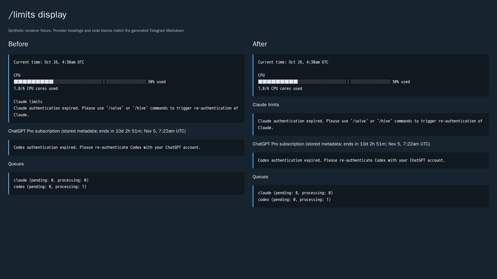

# Issue 3785: limits, rotating credentials, and task state

Investigation dates: 2026-10-26 and 2026-10-30. Issue: [3785](https://github.com/link-assistant/hive-mind/issues/3785).
Implementation: [PR 3786](https://github.com/link-assistant/hive-mind/pull/3786).
Baseline: `43ea0960bec147c1a723d3265af9e9e65852cab6`, Hive Mind 2.39.7.
Observed failed CLI: Codex 0.164.0. Local Claude CLI: 2.1.310.

**The issue remains unfinished.** Display, entitlement labeling, cache invalidation,
Router usage selection, and task-owned Codex catalog discovery are implemented.
The default canonical authentication/history contract, complete global baseline enforcement,
migration, and packaged-image release/deployment gates are not implemented or
verified by these changes. Passing the tests below does not satisfy those criteria.

## Recovery on 2026-10-30

The interrupted session's complete trace is retained as
[compressed sanitized evidence](evidence/interrupted-session.log.gz), with its
content digest and sanitization procedure in the adjacent manifest. The historical
2026-10-26 possible-cybersecurity-risk error occurred during synthetic native
refresh crash-recovery maintenance. The requested suspected false-positive report
is [openai/codex 58320](https://github.com/openai/codex/issues/58320); a deterministic
classifier trigger has not been established. Current main was merged while
preserving the interrupted changes and both branches' behavior.

The original two failures are repaired: security run 41051640552 accepts sharp
0.35.5, and unconditional process-group cleanup fixes the native TUI fixture's
surviving catalog helpers. Run 41051640537 builds the full Codex CLI and passes
actual TUI, history, refresh owner-death and explicit-login repair controls.
It then fails the ChatGPT request fixture because startup catalog discovery
precedes the per-thread loopback override. The fixture now selects its local
provider at startup and refuses every external proxy tunnel before TLS. The
actual downloaded executable passes both live-client auth modes, eight provider
overrides, eight constructor/compatibility controls, crash/login repair and TUI
controls locally. [Structural results](evidence/native-network-controls.log)
retain the scope of those passes. Four stale identity publications reproduce across nine actual scenarios,
including API-key mode with retained OAuth tokens. All twelve focused writer
tests pass after the login/mode repair; [structural evidence](evidence/native-identity-mode-controls.log)
keeps that result separate from the pending full native CLI verification.

Seven exact native Codex transaction tests preserve explicit login repair of
malformed JSON without allowing another consumed-predecessor exchange. Qwen's
actual OAuth writer no longer mistakes a metadata-only rewrite for a fresh
refresh token: all 14 writer controls, including non-rotating responses and
legacy uncertainty, pass locally and in native run 41051640593. These source
experiments remain outside production.

The actual Claude 2.1.310 executable passes healthy/expired request, ordinary
concurrency, pending fresh-login and pending logout controls. The strict synthetic
owner-death test still fails: a peer retries the consumed predecessor after its
owner dies before receiving a response. [Retained results](evidence/claude-native-refresh-controls.log)
and the [native experiment](../../../experiments/issue-3785/native-claude/README.md)
distinguish this defect reproduction from a fix and from the live provider's
unverified replay/grace policy. A separate actual completed-conversation control resumes a shared transcript
after private-home disposal; the next model request includes the earlier
message. Full Claude crash semantics, history lifecycle and integration remain
open.

Native run [41064060494](https://github.com/link-assistant/hive-mind/actions/runs/41064060494)
now passes the complete Claude experiment, including the expected crash-defect
reproduction and both history controls. This verifies the TLS fixture repair;
the native crash defect remains unresolved. Qwen run 41064059810 also passes.

The pinned Claude binary additionally loads global `output-styles/*.md` into
a system message when selected by user settings. The previous audit admitted
that configuration. Nine reproducing regressions failed before repair; they
now pass with 56 related controls. Admission inspects conventional/selected
user roots and the documented managed `.claude/output-styles` directory;
user style selection is repairable, while instruction files and managed policy
require explicit reconciliation. Protected auth/history are unchanged. The
[native probe](../../../experiments/issue-3785/probe-claude-native-refresh.py)
has an optional synthetic `--global-output-style` control, retained in CI.
[Anthropic's output-style documentation](https://code.claude.com/docs/en/output-styles)
describes these instruction files and the managed discovery location.
This closes a known discovery gap, not the complete baseline inventory.

Router's unrestricted extra Docker arguments could override its audit path or
volume; all 15 reproducing rejection assertions failed before repair. Extra
arguments now allow only documented resource limits, and token issuance checks
the actual new or reused sidecar's environment and canonical writable volume.
All 51 new controls and both affected older lifecycle suites pass. This checks
declared storage, while audit contents, full conversation retention and the
external backend contract remain open.

The previous checks run fails freshness on 30 stale declarations/lock entries. Current Formal AI,
act, lino-objects-codec and allowed-range dependencies are refreshed; deliberate
native CLI pins use the existing verified-open-issue exception policy. The
local freshness gate passes with zero lockfile lag. All 728 default test files
pass with refreshed dependencies in two documented batches, including the failed
Formal AI pin fixture retried at the same file. Full lint, formatting, secret
scanning, changeset, file-limit and duplication checks pass. Newest-head CI is
still required. Local Docker execution fails before
container startup because runc cannot enter the available cgroup. See the
[CI investigation](../../../ci-logs/issue-3785-investigation.md) and
[acceptance inventory](requirements.md) for the exact remaining scope.

## Evidence and incident sequence

The complete issue and both comments were read, along with all PR conversation
comments, inline comments and reviews. The sub-issue API returned no required
sub-issues. Sanitized API captures are under `experiments/issue-3785/`.

| UTC time                             | Evidence                                                                                          | Interpretation                                                                                                                                                                             |
| ------------------------------------ | ------------------------------------------------------------------------------------------------- | ------------------------------------------------------------------------------------------------------------------------------------------------------------------------------------------ |
| 2026-10-25 14:59:28                  | Original issue and two screenshots                                                                | Claude's auth error is inside the system metrics block; Codex has a separate heading, a future subscription date, and an auth error. The queue reports one Codex task processing.          |
| 2026-10-25 15:10:44                  | Checks and release run 40205703613, head `43ea0960`                                               | `action_required`, no jobs/logs. This is an approval state, not evidence of a failing code assertion.                                                                                      |
| 2026-10-25 15:13:03.789              | Failed task log, lines 359–362                                                                    | Codex 0.164.0 receives refresh HTTP 401 and reports a refresh token already used.                                                                                                          |
| 2026-10-25 15:35:24, edited 18:51:02 | [First comment](https://github.com/link-assistant/hive-mind/issues/3785#issuecomment-6399598109)  | Operator compares the surviving scoped task credential with the stale base and newly failed task. Subsequent tool calls establish continuing execution independently of the queue counter. |
| 2026-10-25 21:51:04                  | [Second comment](https://github.com/link-assistant/hive-mind/issues/3785#issuecomment-6403814424) | Operator reports completed server cleanup and control-center guard, and requires structural isolation and release gates here. Cleanup is not proof of launcher enforcement.                |
| 2026-10-26                           | Synthetic production-preflight probe                                                              | Task A rotation stays private, B copies the predecessor, and repeated A preflight overwrites A's replacement.                                                                              |
| 2026-10-26                           | Docker probes, including real Codex 0.164.0 with networking disabled                              | File mounts retain old inodes; mounted files cannot be replaced/unlinked; a directory-mounted control supports real CLI logout/login.                                                      |

The private bot log contains successful and later failed Codex usage responses.
Its authenticated Claude profile has `account.has_claude_max: true` and
`organization.subscription_status: active`, but no reliable paid-access end date.
The local credential's plan label and a JWT subscription date are independent
of whether a new authenticated usage request succeeds.

The historical successful token-exchange response was not captured. Identifying
the surviving task's refresh as the consumption event is an inference supported
by the operator's generation comparison, the copy path, and the reuse error.
The original queue counter alone would not establish this.

### Retained artifacts

- [Original display screenshot](evidence/original-1.png) and
  [browser usage screenshot](evidence/original-2.png): downloaded, identified as
  PNG with `file`, and visually inspected.
- [Before/after renderer comparison](evidence/display-comparison.png), generated
  from synthetic data in a real browser. This is a Markdown layout fixture,
  not a live Telegram or provider screenshot. The same subscription helper is
  used in both columns, so the comparison isolates section placement.
- [Failed execution log](evidence/failed-task.log.gz) and
  [complete related bot log](evidence/bot.log.gz): sanitized before compression.
  `gzip -dc` restores readable logs. Inspect at most 1500 lines at a time.
  [Manifest](evidence/manifest.json) records sanitized-content hashes and sizes.
  The raw files, download URL credentials, account identifiers and emails are
  not published. Sanitization and a residual scan used the repository's
  fail-closed streaming sanitizer with 64 KiB chunks and a 192 MiB JS heap cap.
- Reproducing failures and probe outputs are in `evidence/*-before.log`,
  `evidence/auth-copy.log`, `evidence/file-mount.log`, and
  `evidence/codex-storage.log`, and `evidence/concurrent-refresh.log`. Successful focused tests are in
  `evidence/limits-final.log`. Synthetic test outputs have trailing whitespace
  removed; compressed incident logs retain the sanitized bytes in the manifest.

## Root causes and changes

### Section placement and entitlement provenance

`formatUsageMessage()` previously used a subscription heading as the condition
for creating Claude's section. When the profile request failed, no subscription
object existed; the same error text was appended to the system metrics block.
Claude now gets a fallback limits heading even when subscription metadata is
unavailable. Codex also gets a separate section without a plan/metadata object.

Claude plan detection previously preferred `claudeAiOauth.subscriptionType`
from disk. An authenticated profile's account entitlement flags now take
precedence. Explicit false flags for both Max and Pro identify free access;
a missing/unauthenticated profile does not imply cancellation. A cancellation
status alone does not remove a still-active paid entitlement.

Codex subscription claims are decoded locally and are not verified by that
operation. The heading now labels them as **stored metadata**, including when
a future date accompanies HTTP 401. This label is localized in English,
Russian, Chinese and Hindi. A fresh usage request still determines whether the
request credential works.

### Cache identity and effective homes

Successful usage and subscription results could outlive credential rotation or
logout. Authentication failures were invalidated only by modification time;
an atomic replacement with the same mtime could leave a stale failure cached.
Concurrent requests for different credential paths could share one request.

Cache entries and in-flight requests now include the resolved credential path
and file generation (`dev`, inode, nanosecond mtime/ctime, size). Both successes
and auth failures check the generation. Logout invalidates stored subscription
claims. Existing rate-limit cooldown behavior is retained. Credential values
are not put into cache keys or diagnostics.

A full local run also exposed intermittent queue-test interference: automatic
consumers continued usage checks after `stop()`, while later tests reset the
cache. Pending usage requests were shared across cache instances. A deterministic
regression fails before the fix (14 passed, one failed); requests now coalesce
within their cache instance, and all 22 focused cache/limits tests pass. Queue
unit tests disable automatic consumers and explicitly exercise their operations;
all 71 assertions pass. Production queue startup behavior is unchanged.

Native `/limits` credential readers resolve `CLAUDE_SECURESTORAGE_CONFIG_DIR`,
`CLAUDE_CONFIG_DIR` and `CODEX_HOME` at call time. This removes an unconditional fallback to the default home; it
does **not** validate that a redirected home is the deployment's canonical
authority. The launcher-level effective-path validation remains unfinished.

Verbose usage diagnostics used to record token suffixes, account IDs, all
response headers and raw bodies. They now retain structural usage-window
information and HTTP status only. Malformed credential/provider JSON errors
also omit input excerpts from diagnostics and returned messages. Provider
requests have a 30-second bound. A later CodeQL review identified that the
successful subscription diagnostic still carried a credential-derived plan
label; it now emits a constant message. A regression preserves returned
metadata while proving credential/provider sentinel values stay out of logs.

### Explicit Router usage authority

When `HIVE_MIND_USE_ROUTER` selects Router, `/limits` requests the selected
Router's `/api/usage/anthropic` or `/api/usage/openai` schema-v1 endpoint with the
Router client credential. Usage and subscription metadata share that response.
An unavailable/unverified result, missing token, unsupported schema or HTTP
error returns a Router-specific error; it never falls back to vendor auth files.
The adapter retains named windows, additional metered Codex limits and credits.
This uses the existing backend API rather than independently refreshing OAuth.

The Docker command builder also had an explicit native-mount fallback when
Router was selected without an issued task token. It now rejects missing tokens,
invalid endpoints, invalid dialects and dialects without a provider route before
constructing vendor mounts. Task and Git routes use the dialect selected by the
launch environment rather than an unrelated process-global image selection.
Route validation precedes lease acquisition, and the lease carries that dialect
through attachment, Codex provider-file wiring and coverage diagnostics. Regression tests first
reproduced premature acquisition and loss of the selected dialect at both steps.
The broader backend storage/audit contract remains unvalidated.

The repository pins Router 0.125.4 pending
[3395](https://github.com/link-assistant/hive-mind/issues/3395). That version
does not establish the newer usage API contract. An explicit backend without
the endpoint returns an honest unavailable result. This patch neither changes
the pin nor certifies Router's broader auth/storage/audit isolation contract.

### Catalog discovery isolation

Codex preflight previously listed available plugins using the root home, then
linked writable root `.tmp/plugins` marketplace state into the scope. Installing
and verifying capabilities in a scope did not isolate discovery itself.
Discovery now runs after task scope preparation with its scoped environment;
marketplace state remains local to that scope. Remote plugin sync is disabled
before discovery, and no root marketplace link is created.

Each preflight now allocates a fresh mode-0700 task home outside the operator
tool directory, including degraded fallbacks. Two tasks for the same repository
cannot rewrite one another's configuration or clear active capabilities. Linked
allocation directories fail before native discovery. The synthetic concurrent,
sequential, failed-preflight and pre-execution teardown regressions pass.
The actual pinned native Codex also passes an offline Docker catalog probe with
concurrent same-repository tasks from checkouts requiring different skills.
Each catalog excludes the peer's skill and operator configuration/auth stay
unchanged. Failed shared-sessions setup refuses execution; fresh-container
recovery checks the shared sessions directory before the historical scope.
Completed execution homes are retained until all native history metadata and
SQLite state have a verified shared projection; subsequent tasks do not reuse
their configuration. Full lifecycle cleanup, other discovery surfaces, startup
restore and migration still require the larger contract described below.

### Existing global-audit repair safety

The existing `runAgentConfigAudit()` could treat malformed/unreadable JSON as
absent and follow linked settings or plugin ancestors during repair. A settings
hard link could modify credentials, and a linked plugin ancestor could redirect
recursive cleanup into conversation storage. Logging also yielded between
inspection and repair, allowing a concurrent edit to invalidate its plan.

Its production entry now validates its existing input paths asynchronously,
rejecting linked roots/ancestors, linked/nonregular configuration files,
unreadable inputs and malformed/non-object JSON before any repair. Configuration reads
use `O_NOFOLLOW`, descriptor identity checks and a fixed 1 MiB limit, including
when a writer grows the file after the size check. TOML syntax is validated with
`smol-toml` before repair; unreadable or malformed Codex configuration cannot
become an empty configuration. Directory enumeration is bounded.
The input generations are checked again after logging before synchronous repair.
The original nine regressions fail against the retained pre-fix implementation
and pass after the change; two more reproduce malformed TOML and concurrent
file growth. They verify synthetic protected content and identity preservation.
Empty-parent pruning now counts hidden entries and uses nonrecursive removal,
preserving stock `.system` files and refusing a directory filled concurrently.
Run `node experiments/issue-3785/probe-audit-inputs.mjs --baseline` to reproduce
the old failures. The same command without `--baseline` runs the current code.

Production callers now require a clean re-audit of these known surfaces before
native connection checks. Remaining findings (including warn-only agents and
commands), repair failures, disabled repair with contamination, and additions
during audit logging reject admission. This is wired into `solve`, `hive` and
the root Telegram bot. Dry-run/command preparation does not repair state.

TOML discovery and repair use the parsed document rather than table-header
matching. Inline/dotted/quoted registrations cannot evade discovery, nested
server settings are removed with their parent, and table-like text in multiline
strings is not mistaken for a registration. The retained before output has 16
failures; all 24 admission regressions pass after the semantic repair. Unrelated
typed settings, approved MCP settings and protected state are preserved.
Repair normalizes TOML formatting and removes comments. Clean configurations
remain byte-for-byte unchanged.

The next baseline reproducer adds 13 initially failing cases: global Claude
instructions/rules and inline hooks, Codex global instructions/prompts and hook
manifests, inline notification/instruction hooks, profile-level additions and
global agent roles. These now block admission. Safe configuration entries are
removed; instruction files and hook manifests are retained for explicit removal
or quarantine. The baseline suite also verifies credential identity preservation,
linked-file rejection, malformed-manifest rejection before unrelated repairs,
and unchanged clean profiles. All 23 baseline regressions pass.

The MCP follow-up first reproduces 30 name-spoofing cases across Claude, Codex
and Codex profiles. Registration admission now checks the supported `npx`
package/argument shape, local transport, empty environment and typed timeout
settings; it rejects arbitrary commands, package sources, scripts, config files,
working directories and injected environment before any repair. A real native
registration probe also established that `CLAUDE_CONFIG_DIR=$HOME/.claude` puts
user MCP state in `.claude/.claude.json`. Ten additional bypasses there reproduced
before adding that conventional path to bounded input and semantic checks.
The focused audit suites pass 128 tests, including unchanged approved settings
and protected credential identity. The real pinned CLIs save registrations
accepted by this baseline in disposable homes. Arbitrary effective config paths
and executable/package integrity still require broader attestation.

Task-scoped Codex configuration had a separate semantic bypass: its regex only
removed one plugin-header spelling. Six valid quoted/dotted/inline/nested TOML
forms retained operator plugin declarations, and a header-looking multiline
string was corrupted. Eight of nine new regressions fail before the fix.
The scoped builder now parses TOML, removes the semantic `plugins` authority,
and serializes unrelated runtime settings with large integers and dates intact.
Malformed input fails before native discovery with a constant diagnostic.
All nine cases and four existing capability/catalog suites pass. This fixes
declaration inheritance; canonical auth copies and the wider task lifecycle
remain unfinished.

Six more global instruction settings in the pinned Codex `ConfigToml` bypassed
the audit: `instructions`, `compact_prompt`, `experimental_compact_prompt_file`
and the three `experimental_realtime_*` prompt/context fields. All 48 user,
selected-home, native-profile, inline-profile and managed-policy regressions
failed before repair. The shared instruction-registration policy now removes
those user overrides and refuses managed overrides without changing admin
policy, runtime settings, prompt source files, authentication or history.
The focused audit set passes all 105 cases. The bounded real CLI probe
`probe-codex-native-global-prompts.py` verifies that `instructions` reaches an
actual loopback model request before repair and native instructions are restored
after repair with the credential inode intact. CI repeats this control using
the stock pinned CLI. The [official configuration reference](https://developers.openai.com/codex/config-reference)
documents compaction overrides; the pinned native source establishes the
additional system and experimental realtime fields. This closes those specific
discovery gaps; complete native surface attestation remains unfinished.

The global `model_catalog_json` selector was another instruction authority:
native model metadata can supply an arbitrary `model_messages.instructions_template`
even with every direct instruction key absent. Eight more audit regressions and
an actual minimal-catalog model request reproduce this bypass. Admission now
refuses user and managed selectors, leaving model/security configuration and the
referenced catalog untouched. The real before/after request control also runs
with `--model-catalog`; repair mode must still refuse and preserve those settings.
Explicit reconciliation in the disposable fixture restores native instructions
and preserves the provider and credential identity.
All 113 focused audit cases pass after including this selector in the shared
policy. Custom model catalogs require explicit reconciliation into task-scoped
configuration rather than root-global instruction inheritance.

The native startup `.env` loader introduces another effective-home override:
its `arg0` code sets non-`CODEX_*` variables before configuration parsing,
including `HOME`. A real native request with a fixed explicit `CODEX_HOME`
reproduces discovery of a skill under the redirected home's `.agents/skills`,
although the launcher audit accepts the original home. All 17 focused refusal,
preservation, unsafe-file and concurrent-addition controls fail before repair.
Admission now treats `.env` in either conventional or selected Codex homes as
an opaque, report-only finding. It neither reads nor deletes potentially
credential-bearing contents. Linked, hardlinked and nonregular inputs are
unsafe; an empty file also requires explicit reconciliation. The native
`--dotenv-home` control verifies refusal in both audit and repair modes,
preserves auth/configuration identity, then explicitly quarantines the fixture
file and confirms that the next model request no longer discovers the skill.
CI repeats this test with the pinned stock CLI. This prevents this specific
startup redirection; it does not establish the full production storage contract.

The pinned Codex profile-v2 loader also reads separate `<name>.config.toml`
files beside `config.toml`. Fourteen reproducing cases bypassed the clean base
file before this audit included those native profiles. Admission now enumerates
native-selectable names with a finite directory-entry limit, validates every
profile before repair, and applies the same semantic policy to each file.
Malformed, linked, nonregular, oversized or concurrently changed profiles reject
all pending repairs. Adding a profile during logging also invalidates the plan.
Safe repair preserves typed runtime settings and auth/history identities.
All 193 surrounding audit/runtime regressions pass, including the original
wrapper's 56 internal assertions. The actual pinned offline CLI discovers a
synthetic MCP registration from a profile-v2 file; production admission now
refuses it without modifying the profile. Run
`node experiments/issue-3785/probe-codex-profile-config.mjs` for that native probe.
This closes a specific discovery gap; complete runtime attestation remains open.

The stock-runtime follow-up starts with nine failures: arbitrary hidden
`.system` content was admitted, and image CLI versions were not pinned. The root, DinD and Coolify image definitions
now pin Claude 2.1.310 and Codex 0.164.0 and disable Claude auto-update. A pristine
network-disabled Codex home materializes 50 stock files; repeated clean runs
produce the same relative-path/SHA-256 manifest. Admission checks installed
stock content against that bundled manifest with bounded descriptor reads and
concurrent identity checks, including nested and hidden files. Extra, changed,
missing, linked and oversized content rejects before unrelated repair. A fresh
home with no stock directory can still initialize; an existing incomplete tree
is rejected. The 12 stock regressions pass, and `probe-stock-skills.mjs --verify`
verifies the real CLI's pristine tree through production admission. CLI upgrades
must regenerate and review the manifest. Actual release-image and deployment
coverage remains unfinished.

The Docker PR check previously installed the published `latest` package, so it
could pass without any runtime implementation from the branch. PR builds now
pack this branch through npm's release file allowlist and install that archive
in both images. All three image definitions require `configure-claude` and run
the installed `verify-agent-runtime.mjs` with build networking disabled. It
checks pinned CLI versions and known global surfaces without repair, creates
a disposable home, asks the actual Codex app-server to materialize stock, and
verifies its complete content manifest. A successful RPC without a stock tree
is rejected. Reads, response sizes and probe duration are bounded; the server
is reaped before its temporary home is removed. Container verification invokes
the installed module again after boot. No development source is mounted for
this check. Two initial package/gate regressions and three Coolify checks fail
before implementation; 19 image/stock checks now pass. A disposable Bun package
installation also passes its installed verifier against the real offline Codex
binary and the local Claude version check. On pushed head `b8f30695e`,
[image job 121471946536](https://github.com/link-assistant/hive-mind/actions/runs/40292596806/job/121471946536)
also built both packaged images and passed the installed verifier during build
and after boot. That verifies the stock gate on actual images; auth/history,
contamination, upgrade and restored-state lifecycle gates remain open.

Image pins also need protection from Hive Mind's idle and command-triggered
updater. Three regressions show that disabling Claude's own updater alone still
allows both attested CLIs to be replaced. All three image definitions now set
the existing `HIVE_MIND_AGENTIC_CLI_UPDATE_EXCLUDE=claude,codex`; four tests verify
the pinned tools stay excluded while other tools and non-image defaults retain
their update behavior. Operator overrides and runtime version re-attestation
remain separate admission concerns.

A real child-process fixture also reproduces inherited parent environment in
the stock probe, and version commands using the parent home. All gate children
now receive only a minimal environment, disposable homes and a fresh working
directory. The Codex probe explicitly uses file credential storage in its
disposable home. The regression starts its parent with synthetic state only;
no operator credentials need to be read to test inheritance. It fails before
the fix and passes afterward, alongside the 21 stock and pin-preservation tests.

This remains a partial guard: effective alternate homes, all native discovery
surfaces, quarantine, deployment validation and
adversarial races during filesystem mutation still need implementation.

The separate native Qwen lock-ownership reproduction is reported in
[QwenLM/qwen-code 15653](https://github.com/QwenLM/qwen-code/issues/15653).
An exiting process that never owned the refresh lock deletes a live owner's
lock; the retained control leaves it intact. This upstream report does not
implement the required production refresh coordinator.

An additional actual-manager reproduction finds stale reads independently of
that lock defect: same-timestamp atomic replacement retains G0, and logout
retains G1. The strict assertion fails before the pinned native read repair.
All 14 local repaired controls pass, including ordinary reads without a polling
grace period, cleared client caches, unsafe storage refusal and healthy recovery.
The [native Qwen experiment](../../../experiments/issue-3785/native-qwen/README.md)
documents exact source bytes, reproduction, bounded execution and remaining
writers/request-admission work. Native CI verification is pending; production
does not load this experiment.

The next pinned Qwen patch coordinates its actual OAuth manager, direct refresh,
device-flow publication and logout with one persistent OS lock and durable
pre-exchange intent. The native client propagates storage refusal; 14 native
client read cases, an observed kernel wait across private configurations and
11 writer/failure controls pass locally. Owner death with an unknown remote
outcome preserves G0 and refuses another exchange until fresh login; a competing
G2 publication survives. `QWEN_AUTH_HOME` separates OAuth storage from private
configuration, but the actual CLI/model path, alternative backends, history,
production integration and full lifecycle matrix remain unfinished. Native
CI confirmation is pending.

### Authentication copies: reproduced and still present

`prepareScopedCodexHome()` calls `syncFileIfPresent()` for `auth.json`;
that helper uses `fs.copyFile()`. Codex then receives the scoped `CODEX_HOME`.
Rotation writes change the scoped copy; `/limits` and later tasks read the base.
Repeated preflight copies the stale base over a newer scoped credential.

Mounting the base file into a container cannot fix that additional copy. Nor
does replacing the copy with a file symlink prove the required contract:
atomic rename replaces the link, logout can remove it, and login can recreate
a private file. A file bind mount holds an inode rather than a live directory
entry, and the kernel rejects replacing/unlinking that mount point.

The offline probe intentionally asserts these failures in the current
production code. Its successful exit means **defect reproduced**, not fixed.
The Docker directory-mount control demonstrates a filesystem primitive only;
it does not isolate config, coordinate refresh or certify vendor histories.

## Upstream research and design constraints

### Claude paid access and billing dates

The authenticated OAuth profile supplies entitlement/status/trial information;
the incident profile did not supply a paid Max end date. OAuth access-token
expiry, refresh-token expiry, usage reset, account creation and subscription
creation cannot establish the paid period end.

Anthropic's [cancellation documentation](https://support.claude.com/en/articles/8325617-cancel-your-pro-or-max-subscription)
says cancellation takes effect at the current billing period's end. Therefore
cancelled renewal and paid access can coexist.

An existing primary implementation,
[CodexBar's Claude provider](https://github.com/bcharleson/codexbar/blob/main/docs/claude.md),
documents cookie-authenticated
`GET https://claude.ai/api/organizations/{org_id}/subscription_details`.
It distinguishes `next_charge_at`/`next_charge_date` renewal fields from
`plan_ending_at`/`plan_ending_before` expiration fields, preferring explicit
termination, and preserves calendar-only dates. OAuth/cookie account and
organization identities must match before and after enrichment. Missing
billing data must leave the end date unknown.

This is a separate web-session authority, not an OAuth profile capability. No
browser cookies were extracted or provider accounts changed during this work.
The research identifies a possible exact-date source but does not claim it is
integrated. A production implementation needs an explicitly configured,
account-checked billing source or an authority that supplies this information.

### Codex and concurrent refresh

[Official authentication documentation](https://learn.chatgpt.com/docs/auth#credential-storage)
places file auth under `CODEX_HOME`; file/keyring/auto/ephemeral storage choices
are not a supported independent shared-auth-home switch. Other state/config
paths must also be inspected, including SQLite home overrides.

The exact requested separation is already reported in
[openai/codex 15410](https://github.com/openai/codex/issues/15410), closed as
not planned, and the copied-home documentation gap is tracked in
[15502](https://github.com/openai/codex/issues/15502). A
[new evidence report](https://github.com/openai/codex/issues/15502#issuecomment-6408380122)
adds the bounded reproductions, real CLI mount behavior, workaround limits and
code-level interface suggestion to the existing issue rather than opening a
duplicate. Its exact submitted text is retained under `experiments/issue-3785/`.

For the observed version, [file storage source](https://github.com/openai/codex/blob/rust-v0.164.0/codex-rs/login/src/auth/storage.rs)
uses `$CODEX_HOME/auth.json`; deletion removes that path, and file saving opens
with create/truncate. The [authentication manager](https://github.com/openai/codex/blob/rust-v0.164.0/codex-rs/login/src/auth/manager.rs)
has a process-local refresh guard and reread. A JS lock in Hive Mind cannot
serialize a vendor process that never acquires it. A refresh lock must cover
canonical reread, provider exchange and atomic commit for **all** refreshers.

A fourth bounded probe uses two actual Codex 0.164.0 processes sharing one
**directory-mounted** auth store and a local synthetic OAuth provider. The
provider holds responses until both processes submit generation G0, then accepts
one exchange and rejects the other as consumed-token reuse. G1 is committed to
the shared store. This reproduces the exchange race independently of credential
copies and file-mount behavior; it does not verify a coordination fix. Networking
is disabled, no real credentials are mounted, and request bytes are not logged.
The CLI's model requests intentionally receive a local 503; command success is
not the probe's assertion. See `evidence/concurrent-refresh.log` and
`experiments/issue-3785/probe-concurrent-codex-refresh.sh`.

The pinned CLI does have integration hooks that warrant an adapter experiment.
Its [command-backed provider auth](https://github.com/openai/codex/blob/rust-v0.164.0/codex-rs/login/src/auth/external_bearer.rs)
invokes a configured helper and constructs API-key-mode auth from its output.
That helper could participate in a broker lock, but native ChatGPT account
semantics, logout/login and canonical history are not established by that hook.
The [app-server external-auth bridge](https://github.com/openai/codex/blob/rust-v0.164.0/codex-rs/app-server/src/external_auth.rs)
can request refreshed ChatGPT tokens from a client. Using it would require a
different execution adapter: the pinned [CLI dispatcher](https://github.com/openai/codex/blob/rust-v0.164.0/codex-rs/cli/src/main.rs)
explicitly rejects remote app-server mode for `codex exec`, which Hive Mind
currently drives. The installed CLI's generated login schema explicitly marks
external ChatGPT-token login as internal and unstable. A bounded offline
experiment nevertheless verifies one client's external callback: the actual
app-server receives synthetic G0, a local provider returns 401, the external
owner atomically commits G1, and the CLI's next model request carries G1.
No native `auth.json` is created. The synthetic tokens retain the same account
and user identity across rotation. The model deliberately returns 503; the
assertions concern the callback and request credential, not successful inference.
See `probe-appserver-auth.mjs`, `inspect-codex-auth-hooks.sh`, and their retained
structural outputs. The later `probe-appserver-concurrent-auth.mjs` runs two
actual app servers and two callback workers in separate containers. Both workers
select the same host-backed lock inode and reread the generation after acquiring
the lock. With locking disabled, the synthetic provider observes two exchanges
of G0 and rejects its reuse. With locking enabled, it observes exactly one
exchange; both native clients next send committed G1 without private auth files.
Removing a third lock-owning container also releases the lock for its peer.
See [the structural results](evidence/concurrent-external-auth.txt).
The finite probe uses disposable synthetic state, a Unix-socket provider,
network-disabled containers, bounded heaps/data limits and awaited cleanup.
Neither hook is integrated into production execution or direct host CLIs;
login/logout and full history remain unverified through this path. The native
external bridge also caches its access token until a refresh callback; this
probe does not establish a canonical reread before every native request.
These interfaces make a broker a research avenue; they do not establish that
the full contract is impossible or already supported by this launcher.

Claude has an existing open report for
[credential symlink replacement and concurrent state loss](https://github.com/anthropics/claude-code/issues/76561).
It is corroborating upstream evidence, not a real Claude refresh reproduction
in this workspace. Claude also documents an existing shared refresh lock;
the Codex race must not be generalized to Claude. Its actual cross-container
behavior must still be tested in the required packaged-image matrix. The
[versioned six-tool storage inventory](storage-inventory.md) records distinct
config/data/runtime interfaces and the remaining verification gaps.

Router already documents coordinated backend refresh and a redacted usage API
in its [primary README](https://github.com/link-assistant/router). Its newer
Rust usage schema and HTTP tests informed the adapter. That does not make an
explicit experimental Router selection a substitute for the requested default
native contract, and it does not prove unmanaged host CLIs participate in its
refresh lock.

## Required implementation still open

The stock CLI storage interfaces above do not establish a way to satisfy the
entire default contract by changing paths alone. A supported per-tool storage
adapter, participating CLI change, or broker architecture is needed. Existing
upstream reports document this constraint; no approved upstream adapter was
verified here. This is an external constraint on the native integration, not
evidence that the remaining launcher work is complete or impossible.

The following implementation sequence remains required:

1. Establish each tool's supported canonical auth/history adapter. Inventory
   Claude, Codex, OpenCode, agent, Qwen and Gemini storage, including archives,
   indexes, databases and resume metadata. All native readers/writers, including
   the host, must use the same authority. Remove all credential copies only
   when the real replacement is validated; do not install a symlink workaround.
2. Resolve daemon-side mount sources from inspected root mounts for host-socket
   and nested-daemon deployments. Validate source identity and effective paths
   before admitting task code, after preflight, and during resume. Unsafe,
   redirected, missing or changed authority must fail closed.
3. Serialize refresh across processes/containers with canonical-generation
   reread before exchange, atomic commit, and safe logout/re-login. Preserve the
   surviving good generation before any real recovery or cleanup. No live
   credential repair was attempted in this workspace.
4. Create fresh per-task config/extension storage, with discovery in disposable
   task-owned state. Share neither root config nor writable catalogs. Enforce
   the root Playwright-only baseline across effective home/profile, managed,
   alternate, legacy, synced and marketplace surfaces. Compare stock `.system`
   bytes against a pristine instance of the same pinned CLI version.
5. Replace full-home restore/watch with an explicit migration allowlist. Keep
   auth, full conversation evidence and approved Playwright; quarantine
   extension state without traversing unsafe links or losing newer auth.
   Reject malformed/contaminated root state before deployment or launch.
6. Define and validate explicit alternative-backend authority and audit/storage
   contracts. Suppress vendor credential mounts, prohibit silent fallback, and
   retain full conversation discovery/resume independently of request logs.
7. Add required real-image tests and make release/deploy promotion depend on
   them. Cover root plus two concurrent tasks, different capabilities,
   synthetic provider rotation, repeated preflight, hostile path overrides,
   wrong daemon sources, atomic replacement/logout/re-login, success/failure/
   kill/removal/restart/redeploy/cleanup, upgraded contaminated state and CLI
   upgrades. Skips or unsupported layouts cannot count as passing promotion.

The local Docker daemon can run small probes with `--cgroup-parent /` but the
workspace has no packaged Hive Mind release images. Those images exceed 30 GiB
extracted and the container memory limit is 2.92 GiB. Small Alpine probes are
not evidence that release-image or nested-daemon gates passed. The missing
gates need an adequately provisioned runner after the contract exists.

See [the acceptance inventory](requirements.md) for the mapping of every
requirement to implementation and verification status.

## Reproduction and verification

```sh
# Automated default-suite regressions, synthetic credentials and local HTTP only
node --test tests/issue-3785-limits.test.mjs tests/issue-3785-router-limits.test.mjs tests/issue-3785-router-admission.test.mjs tests/issue-2571-usage-limits-cache.test.mjs
node tests/limits-display.test.mjs
node tests/codex-capability-preflight.test.mjs
node --test tests/issue-3785-audit-inputs.test.mjs tests/issue-3785-audit-admission.test.mjs tests/test-issue-2190-agent-config-audit.mjs

# These reproduce defects; successful exit does not mean canonical auth is fixed
node experiments/issue-3785/probe-auth-copy.mjs
bash experiments/issue-3785/probe-file-mount.sh
bash experiments/issue-3785/probe-codex-storage.sh
bash experiments/issue-3785/probe-concurrent-codex-refresh.sh

# Rebuild the synthetic browser fixture
node experiments/issue-3785/render-display.mjs
```

The Codex Docker probe mounts the installed static Linux CLI read-only into
network-disabled Alpine containers, uses synthetic API-key login, limits PIDs
and data memory, and removes both containers and fixtures. It verifies the
specific kernel `EBUSY` logout failure against the directory-mounted control.
It does not exchange real OAuth refresh tokens.

Before changing production code, the display tests failed, rotation cache tests
failed, catalog ownership test failed, Router selection tests failed, and the
verbose redaction and malformed-response tests failed with synthetic sentinel
values. Retained logs show those failures. The focused limits/cache/Router
tests pass (40 tests). Existing Router isolation, routing, sidecar and hardening checks
also pass after the admission change.
Full-suite/static-check results and current-head CI are recorded in the PR.

Local validation: the default run was interrupted while starting file 500;
the first 499 files had completed successfully. The retained fail-fast runner
log and `run-default-remainder.mjs` verify the interrupted file, all remaining
files and the new updater test: all 702 selected files passed across both runs.
The subsequent environment regression and related stock/updater checks pass
all 22 cases; the actual disposable package probe also passes with that fix.
Final static-check and newest-head CI results are recorded in the PR. The
queue suite passes all 71 assertions. The retained failure outputs reproduce
both the downloaded queue assertion and the later local pending-request race.
The four original storage/copy probes and later stock, callback and package
probes completed and cleaned up. These checks do not verify the unfinished
canonical-storage contract.

The real pinned Codex also exposed a separate stock-gate bypass: a synthetic
admin skill under `/etc/codex/skills` was discovered alongside all five pristine
system skills, and the gate admitted it. Stock file hashes alone cannot attest
the complete native catalog. The retained `native-catalog-before.log` records
that actual failure; the 14 malformed/unapproved catalog tests also failed
before the change. Admission now requires one error-free result for the
requested directory and exactly the five pinned names, private paths, enabled
flags and system scopes, without duplicates or plugin associations. The real
contaminated probe is rejected after the fix; the actual installed-package
probe still accepts pristine discovery. All 15 catalog cases and 46 related
stock, admission, environment and updater checks pass. This verifies the
disposable installed-runtime probe; complete production effective-path and
lifecycle attestation remains open.

The production Docker builder also reproduced a daemon namespace defect:
an auth source at `/operator/.codex/auth.json` inside the root container was
passed unchanged to the host daemon, whose actual backing source had a different
path. The retained `mount-namespace-before.log` records the assertion before
launch. Fresh production launches now compare source device/inode/type values
with a read-only, network-disabled task-image probe. A mismatch can be translated
through the root container's most specific bind/volume mapping, then must pass
the same probe. The bounded mountinfo reader handles partial kernel reads.
Unverifiable sources refuse launch and release acquired service leases. Missing
images retain the detached pull lifecycle. Set `HIVE_MIND_DOCKER_MOUNT_TRACE=1`
for constant stage diagnostics without paths or daemon output.

The actual host-socket probe verifies direct backing, rejects a private root
layer path, and verifies translated auth/session mounts plus a task history write
into the disposable host directory. All 18 mount tests pass; the surrounding
13-file isolation/Router/catalog run passes 56 top-level cases, including the
existing scripts' internal assertions. These use synthetic data and a small
Node image. They verify fresh-launch backing, not native CLI refresh, atomic
replacement, complete history, root/two-task lifecycle, nested-daemon behavior,
effective-path changes or resume. Those acceptance criteria remain open.

PR image verification now requires `docker-pr-verify-mount-backing.mjs` after
the existing regular/DinD checks. It imports the installed package inside each
actual image and uses the host socket or the image's nested daemon respectively.
Two concurrent, bounded Node tasks read synthetic auth and write separate session
files; the gate verifies those writes from the root and host, then cleans up.
Its two local unit tests verify completion and cleanup after success and peer
failure. Actual image execution still needs newest-head CI. This gate exercises
filesystem backing only; native CLI refresh/history and release/deployment
promotion requirements remain unfinished.

Run 40304694014 on `b0ae348d1` skipped Docker checks: incremental detection
recognized image definitions but not the installed branch source or new gate
scripts. A real-detector regression reproduces the source-only skip. Detection
now includes package source/dependencies, startup and verification inputs; the
existing change-range and untested-head suites still pass. Image execution
requires another newest-head run after this correction.

The conventional-home audit also admitted clean homes while explicit
`CLAUDE_CONFIG_DIR` or `CODEX_HOME` selected contaminated directories. Nine
initial regression cases fail before the fix. The audit now includes both
conventional and selected roots in its pre-repair snapshot and final re-audit.
Unsafe linked ancestors/files, malformed state and concurrent edits prevent
all repairs, including unrelated conventional-home changes. Changed selectors
reject repair/admission after asynchronous logging. Tests verify protected
synthetic auth/history identities and unrelated settings survive safe repairs.
Production solve/hive/bot admission and installed-runtime verification pass the
selected environment explicitly; library fixture callers remain independent of
the parent environment. These checks cover the existing known surfaces under
the selected roots, not every managed/search path or canonical storage identity.

Local managed layers exposed another clean-home bypass: all eleven initial
negative cases admitted contaminated or unsafe system configuration. The audit
now checks Claude's managed settings, JSON drop-ins and managed MCP file, plus
Codex system defaults, legacy managed configuration, requirements, adjacent
hooks and admin payload directories. Reads are asynchronous, bounded and use
descriptor identity checks. Linked paths, malformed/oversized documents,
concurrent edits and changed selectors prevent repair/admission. Managed
capability findings refuse launch without rewriting administrator files;
permission restrictions, MCP identity constraints and executable-policy rules
remain byte-for-byte intact. An audit-only invocation reports the findings.

The real offline pinned Codex probe confirms a synthetic system MCP is
discoverable with a clean user home; launcher admission rejects it while
preserving the managed file's bytes and inode. Two further negative tests
reproduced admission of a Claude policy helper and a Codex required config
server. Both can deliver new managed settings after the local file audit;
admission now refuses these unattested dynamic sources without executing a
helper, fetching remote policy or changing their policy files. All eighteen managed
cases pass, including preservation and unsafe-input cases. These are local
file-layer checks, not attestation of cloud-delivered policy, OS policy stores,
all plugin/search paths or native auth/history identity. Those broader
requirements remain unfinished.

Locations and policy distinctions were checked against the pinned
[Codex configuration loader](https://github.com/openai/codex/blob/rust-v0.164.0/codex-rs/config/src/loader/mod.rs),
[requirements types](https://github.com/openai/codex/blob/rust-v0.164.0/codex-rs/config/src/config_requirements.rs),
[MCP constraints](https://github.com/openai/codex/blob/rust-v0.164.0/codex-rs/protocol/src/mcp_policy.rs)
and Anthropic's [managed settings reference](https://code.claude.com/docs/en/managed-settings).
Dynamic policy sources were checked against the pinned
[config-server type](https://github.com/openai/codex/blob/rust-v0.164.0/codex-rs/config/src/config_server.rs)
and Anthropic's [policy-helper reference](https://code.claude.com/docs/en/settings-reference#policyhelper).
The actual managed/native probe ran on Linux; the other platform path defaults
are not an integration-verified policy-store implementation.

The first required packaged mount run on `16abaede3` built both images and
passed their stock gates, then timed out before the host mount probe. The old
loop hid client exec failures. The ordinary pinned Box image and the two
host-socket image definitions did not explicitly supply a Docker client. The
standard and Coolify definitions now copy and execute the official 29.9.2
client; running-image checks execute it too, and mount readiness distinguishes
a missing/broken client from a daemon that is still starting. Five negative
regressions fail before these changes; seven client/mount cases pass after.
A bounded local probe verifies that exact client reaches the host socket as
an unprivileged user with the socket group. This is supporting evidence;
the complete packaged-image host/nested mount check passed on `e95fd3a6f` in
[run 40312204221](https://github.com/link-assistant/hive-mind/actions/runs/40312204221),
with both concurrent synthetic task writes visible to the root fixture. This
does not cover native refresh, full history or subsequent cloud-policy changes.
Docker documents its [Linux static client distribution](https://docs.docker.com/engine/install/binaries/),
and the client comes from the [official image](https://hub.docker.com/_/docker).

Claude's pinned release can rehydrate capabilities after local cleanup:
[`syncClaudeAiSkills`](https://code.claude.com/docs/en/settings-reference#syncclaudeaiskills)
and [`syncClaudeAiPlugins`](https://code.claude.com/docs/en/settings-reference#syncclaudeaiplugins)
default to account sync, while
[`disableClaudeAiConnectors`](https://code.claude.com/docs/en/settings-reference#disableclaudeaiconnectors)
defaults to allowing cloud MCP connectors. Admission now requires explicit
`false`, `false` and `true` respectively, plus environment values disabling
connectors and official-marketplace auto-installation. Repair-disabled launches
reject even a missing settings file; enabled repair seeds or merges these
values without touching auth/history or unrelated security/provider settings.
Managed settings that explicitly enable account sync, connectors or either
environment switch also reject admission before user repair, without changing
administrator files. Restored `plugins/synced` payloads are removed
through the validated repair path.

The first ten cloud regressions all failed before implementation, and a separate
restored-payload regression reproduced its discovery gap. Three additional
regressions reproduced managed-policy overrides. All sixteen final cloud
cases and the expanded 260-case surrounding selection pass, including a real
`configure-claude` subprocess writing only the selected disposable native home.
Both configuration helpers now resolve `CLAUDE_CONFIG_DIR` consistently with
admission. All three image definitions carry the connector environment pin;
their existing configuration command supplies the settings pins. This verifies
local policy and command routing. Authenticated native account rehydration,
complete search-path attestation and the full image lifecycle matrix remain
unverified and required.

Coolify previously kept `tail -f /dev/null` alive after Hive Mind startup failed,
and did not validate the restored home before offering its setup terminal.
Its startup now runs the installed read-only runtime verifier before checking
GitHub setup or starting Hive Mind. A failed gate exits immediately, and a later
Hive Mind failure preserves its nonzero exit status. Clean unconfigured
deployments retain the existing setup terminal. Five regressions execute the
actual shell payload with mocked external commands; all fail before the change
and pass afterward. These tests verify startup ordering and failure propagation,
not full packaged Coolify boot, canonical-storage validation or migration.

The completed local default-suite run passes all 710 selected files. That run
started before the cloud-policy edits; the later 260-case focused run covers
those changes separately. The five deployment tests are an additional run.



Agent 0.27.0 and OpenCode 1.19.4 have separate native XDG data/config roots.
Their Docker tasks now mount the selected host data directory at the native task
data path, rather than starting with private auth/history. The directory carries
credential replacement, deletion/recreation, native conversation storage and
sidecars. Agent's legacy executable cache inside that directory is masked by a
private non-executable tmpfs; its pinned native implementation prefers `rg` on
PATH. Local Docker search execution with that mask now passes; the actual packaged-image run still requires CI.
OpenCode is now pinned in all three image definitions, both layout-dependent
tools are excluded from image auto-updates, and the installed runtime gate checks
both exact versions in disposable state.

Preparation rejects unsafe ancestors and unavailable backing. The launcher
records device/inode identity, verifies the daemon mount source, and passes a
structural identity marker. Agent/OpenCode check it before validation and after
preflight/provider setup, then immediately before fresh/resumed native execution.
A different data directory, replaced directory inode, configuration/cache/state
overlap, linked explicit config, OpenCode inline auth or a private OpenCode DB
rejects execution. Router tasks receive no vendor data directory or identity.
This marker is admission metadata, not an authenticated security boundary. Host
launches without a marker and in-flight path changes still need the complete
canonical authority contract.

The initial directory tests failed 10 of 13 cases before implementation; four
additional tests reproduced cache/state overlap and linked-config bypasses.
The final focused selection passes 28 tests. The real local Docker gate executes
the production mount planner, namespace resolver and installed-validator source
with two concurrent synthetic filesystem participants. Both tools pass host and
task atomic replacements, peer history-marker visibility, unlink/recreation,
private redirection rejection, and Agent's private executable-cache checks.
The same gate is required inside both packaged-image daemon layouts; this
new gate still needs its first packaged CI execution. The preceding cloud and
Coolify changes passed both image builds and post-boot checks in
[run 40315657485](https://github.com/link-assistant/hive-mind/actions/runs/40315657485)
on `4c96f79544c327bd908c565472fce365c41be312`.

A separate bounded loopback-provider experiment executes the actual installed
Agent and OpenCode entrypoints with private participant homes/config/cache/state
and one shared data root. Native task A writes a conversation; the host atomically
replaces synthetic API credentials; native task B resumes A's session, sends its
prior messages and reads the replacement credential. Both pinned tools pass.
OpenCode's earlier finite-deadline failures were a harness error: its
[native run command reads piped stdin to EOF](https://github.com/anomalyco/opencode/blob/v1.19.4/packages/opencode/src/cli/cmd/run.ts#L417),
so the harness must close its unused input pipe. This is not an upstream startup
defect. The experiment remains in `experiments/issue-3785/probe-xdg-native-storage.mjs`;
Docker backing checks remain in `probe-xdg-docker-storage.mjs`. Structural output
is retained in `evidence/xdg-storage-probes.txt`. These probes do not establish
OAuth refresh serialization, native auth writes, concurrent native Docker
sessions, the other four CLI projections, allowlist migration, or release/deploy
lifecycle gates. All corresponding acceptance rows remain unfinished.

The packaged Docker job used to be restricted to pull requests. Automatic and
manual release jobs depended on it but permitted `skipped`, so publication could
proceed without executing the image tests on the release commit. Its condition
now includes every main-branch publication candidate, including test-only code
changes and manual releases with no detected diff. Both publishing jobs require
the Docker result to be exactly `success`. Docs-only main pushes and PR image
selection keep their prior behavior. A regression evaluates the actual trusted
workflow conditions across those event/result combinations: four cases fail
against `4c96f7954`, and all five pass with the updated conditions. Existing
release-order, cancellation and credential-preflight tests also pass. The
retained experiment replays an earlier workflow without changing the checkout.
This enforces the currently implemented image gates before publishing; it does
not supply the unfinished native refresh/history, contamination, migration or
full deployment matrix. Actual publishing is intentionally not exercised from
the issue branch.

The pinned Linux Claude 2.1.310 binary supports an independent credential root,
`CLAUDE_SECURESTORAGE_CONFIG_DIR`. An explicitly empty value selects
`HOME/.claude`, even with a relocated `CLAUDE_CONFIG_DIR`; native paths normalize
Unicode to NFC. This is also described in an
[upstream documentation issue](https://github.com/anthropics/claude-code/issues/79223).
Three regression tests reproduced `/limits` selecting the wrong credential path.
The resolver now follows these native rules; all 18 limits regressions pass,
and the wider focused cache/display/Router/Telegram selection passes too.

A bounded native probe creates only synthetic credentials in disposable state,
then executes `auth status --json` and `auth logout` with a minimal environment.
Status selects the independent root, and logout removes its credential while
leaving the private configuration and conventional default credentials unchanged.
The explicitly empty selector selects the conventional store as expected.
`experiments/issue-3785/probe-claude-secure-storage.mjs` retains the probe, with
structural output in `evidence/claude-secure-storage.txt`. This verifies Linux
status/logout selection, not fresh entitlement, login, refresh coordination,
Docker credential projection or complete conversation persistence. The native
selector makes separate auth/config routing possible; the legacy production
Claude file mount has not yet been replaced.

The 714-file local default run completed 626 files before its process ended
externally. A retained resume script restarts at the interrupted file; all 88
remaining files pass. Together these cover the original selection. The added
release-condition file passes independently, and the later Claude changes have
the focused coverage above. Logs remain local under `/tmp/issue-3785-*`.

The Router credential guard previously watched only conventional Claude paths.
Nine focused cases show eight bypasses before repair and all pass afterward:
selected credential/config roots, relocated account state, a selected settings
helper, and four settings-based path/credential-source redirections. Limits and
the guard now share one native credential-root resolver. Existing Router guard
behavior for transient half-written account state is retained; complete strict
backend admission/audit and all native credential sources remain unfinished.
The broader Router/limits selection passes 47 node tests, including the legacy
guard's 114 internal assertions. No helper or provider request runs in these
fixtures.

Agent's executable-cache mask requires an executable `rg` on the image PATH.
The pinned Box essentials installer does not explicitly install it, and the
Dockerfiles did not add it. Codex supplies a private bundled search executable,
but its private command path was not in the image PATH. The installed runtime
verifier also accepted missing/broken search commands: two reproducing tests
fail before the new check. A real Docker task using the production mask fails
with `spawnSync rg ENOENT` when no image search command is provided.

All three images now install the architecture-matched executable from pinned
Codex 0.164.0 into `/home/box/.local/bin`. The installer verifies both package
versions and actual executable startup before atomic installation; failed
validation preserves an existing executable. Tests cover x64/arm64 selection,
version mismatch, failed/invalid execution and linked destination refusal.
The installed runtime gate checks search startup, and the required two-task
mount gate actually executes search with the production cache mask active.
A small local image built from the cached Node base and the real bundled `rg`
passes both tool-directory probes, including search in both Agent tasks. This
is a local Docker proof, not a completed Box-image or native Agent lifecycle
matrix. The focused storage/search/detector selection passes all 37 cases.

The real change detector also skipped `scripts/install-image-package.sh` updates.
A reproducing throwaway-repository test records `docker=false`; image installer
scripts now select the required Docker gate. Both installer paths are covered.
Structural evidence is retained in `evidence/image-search-runtime.txt`.

Gemini and Qwen also had unpinned image installations and remained automatic
update targets despite the version-specific storage inventory. Six regressions
reproduce missing version admission and update exclusions; the expanded related
selection passes 54 cases after pinning Gemini 0.65.0 and Qwen 0.26.1. The real
installed Agent, OpenCode, Gemini, Qwen and search commands pass a bounded
version probe in disposable state. All six tool pins are preserved by image
update exclusions. This is version admission, not the native storage matrix.

A later 719-file full local run stopped at file 166: the usage-cache credential
rotation regression observed unchanged inode, size and mtime/ctime after a
same-size in-place rewrite on the container filesystem. A finite twenty-rewrite
regression reproduces stale reuse before repair. Generation comparison now adds
a SHA-256 digest read through a bounded regular-file descriptor (maximum 1 MiB),
refuses linked/nonregular inputs and never logs bytes or digests. All 26 focused
cache/limits cases pass after repair. The failed full run is not counted as a
pass; a new complete run was started. Evidence: `evidence/cache-generation.txt`.

The external-auth worker now uses the packaged
`src/shared-auth-refresh-lock.lib.mjs` primitive instead of wrapping its entire
process in an experimental shell lock. It validates a private canonical
directory and regular single-link lock, acquires a stable inode through a
parent-owned descriptor and Linux `flock`, and rechecks identity before commit.
It never deletes the lock. Ten tests verify independent-process generation
rereads, one predecessor exchange, forced owner death, rejected operations,
bounded/cancelled waiters and unsafe/replaced lock refusal. The actual native
two-container negative and positive controls were rerun against this module;
without locking both workers exchange G0, with locking exactly one does and
both native clients use G1. This is a reusable primitive plus an experimental
consumer. It does not coordinate a native or host writer that bypasses it,
replace production exec, or establish immediate cache invalidation. A5 stays open.

Native Codex run [40360472411](https://github.com/link-assistant/hive-mind/actions/runs/40360472411)
at `24ef9e65afed8a372df00f8f24190896dd00529b` passes the additional synchronous
request-provider controls. All nine manager cases reproduce their defect before
the corresponding patch and pass afterward; the full CLI builds and passes
status, replacement, logout, API-key reauthentication/peer status and refusal.
Seven descriptor-storage tests also pass. This verifies the experimental source
adapter, which remains outside production. Other native writers and complete
refresh crash semantics still need implementation and verification.

Rollout recovery had a separate data-loss race: legacy migration checked for a
name before overwriting it with rename/copy, and stopped-container recovery copied
over concurrent canonical writes. New tests reproduce both paths. Publication
now stages and syncs a private copy on the destination filesystem, then links
without replacing an existing name. It retains original migration directories
and durable conflicting recovery snapshots. A linked destination refuses admission.
Three more regressions reproduce rejected compressed/reverted native filenames.
The matcher now accepts all four pinned native formats by stable thread identity.
All 37 focused cases pass. A bounded real Codex Docker probe reads and resumes
synthetic prior content before and after actual stopped-container recovery for
all four formats; it resets original bytes after the control so native resume
cannot hide a format error. Evidence and limits are recorded in
[evidence/rollout-preservation.txt](evidence/rollout-preservation.txt). Full native
history/index/SQLite authority and execution-home cleanup remain unfinished.

A further real native probe reproduces private writer locks admitting two owners
of one thread and native archiving moving history out of canonical storage.
Fresh task scopes now share `sessions`, `archived_sessions` and
`thread-writer-locks`; Docker projects all three host directories and refuses
unavailable or linked history storage. Recovery preserves archived location.
All eight new regressions pass, and the surrounding selection passes 41 cases.
Real Codex 0.164.0 now refuses the second writer and preserves archive/read/
explicit-unarchive/resume across fresh configurations. Both bounded native
probes are required by CI, and packaged host/nested backing gates now exercise
all three directories. Full indexes, SQLite, maintenance coordination and
successful execution cleanup remain open under A9.

The next actual-request control finds a limit in the passing manager tests.
Native CI run 40370836766 builds the coordinated CLI and passes every manager
case, but its downloaded executable still sends an auth-required model request
without Authorization after canonical logout. Two live clients reproduce this
in both API-key and managed ChatGPT modes; atomic G1 replacement and G2 recreation
work. The provider's missing-auth fallback is the traced cause. The exact-source
guard compiles in run 40376400046 and its actual-request positive control passes
for both modes/peers, including malformed/unsafe/logout refusal and repaired
authority. Run 40384255301 also verifies all eight provider-override refusals and both
stock metadata controls. Alternate constructors and production integration remain open.

Sharing native SQLite alone also fails the named-thread disposal control:
`thread/read` can retain the name, but a fresh native `thread/resume` loses it
without the session index. The experimental index selector routes native scans,
appends and removal into one private authority with stable locking and synced
atomic rewrites. Five standalone tests pass, including rewrite/append contention
and forced owner death. Run 40376400046 compiles the full CLI, passes all 20
selected upstream/index tests and verifies real name/read/resume and peer
updates after both configurations are disposed. Production keeps its current native CLI;
A1/A5/A9 and the full lifecycle matrix remain open.

Three additional regressions reproduce history I/O errors being treated as an
absent rollout and failed inspection being cached as successful. Only ENOENT
now permits missing-history behavior; EACCES/EIO refuse resume/recovery on every
attempt before copying or dropping the resume identity. All 28 surrounding
tests pass. Structural evidence is in
[evidence/native-request-and-index.txt](evidence/native-request-and-index.txt).

Prompt recall is another independent native history store. The pinned
`CODEX_MESSAGE_HISTORY_HOME` experiment adds stable directory locking and
streamed atomic publication without a private `history.jsonl`. Native TUI
logical IDs survive data replacement; bounded batch continuation retains row
offsets across publications. The focused harness reproduces split/lost history
and passes 14 repaired controls, including eight concurrent appends, owner
death and 141-row pagination; all 12 upstream tests pass. It uses exact native
history modules with only two passive config value types stubbed after the full
transitive compiler hits its 1 GiB limit. Run 40384255301 separately compiles
the actual native crate/full CLI and passes those 14 controls and 12 tests.
The downloaded CLI still reproduces unsafe-history model execution through the
TUI; the pinned ordering repair awaits native compilation. Remaining writers
and production integration stay open. See [prompt-history evidence](evidence/native-message-history.txt).

The next actual Qwen CLI control preserves the native OAuth-sunset refusal,
then reproduces independent API-key model execution despite selected canonical
OAuth authority. The strict zero-request test fails before the new pinned
provider-factory guard and passes locally afterward. Five alternative provider
modes, six OAuth overrides and 15 retained-provider methods refuse; the
no-selector CLI still completes its synthetic loopback request. Current
API-key/Coding Plan canonical storage remains open. See the native-Qwen
experiment README for exact commands and boundaries; fresh CI is required.

The latest Gemini terminal experiment preserves actual restorable tool metadata
and its Git/conversation history after complete private-home disposal. It also
reproduces an approved edit running with damaged metadata and binds the actual
native writer before approval and execution. Healthy restore, live refusal and
fresh startup refusal pass; 26 API scenarios / 30 native process results and
seventeen byte-identical reconstructed native files provide separate evidence.
See [terminal restore controls](evidence/native-gemini-restorable-controls.txt).
Remaining history/lifecycle coverage, migration and production installation
remain open. The preceding pushed commit 40db3a6e3c0 passes all eight
workflows, including all four Gemini jobs, three compiled Codex jobs, 739 default
files, both integration files and packaged host/nested Docker checks. See
[exact-commit CI evidence](evidence/ci-40db3a6e3.txt). The new stage requires fresh CI.

All five Node 24 Gemini jobs subsequently pass at `5abb937c55b2` in run
[41153757108](https://github.com/link-assistant/hive-mind/actions/runs/41153757108),
including terminal restore, live refusal and startup refusal. The complete
2933-line workflow log and all 275 terminal-restore artifact files are preserved.

A separate actual ACP experiment reproduces four defects: an approved edit
without a checkpoint, restore leaving later messages in the next model request,
the restored prompt disappearing on a third CLI reopen, and checkpoint listings
showing `Unknown` instead of the saved name and tool. The native ACP
writer now awaits its checkpoint before approval, applies restore to the actual
chat/recorder, preserves context and user turn boundaries, and lists validated
checkpoint names and tools. The full
three-process restore and prior audit retention pass, alongside live/startup
metadata refusals and unselected private recording. Native `replace`, automatic
edits, cancellation and both restore listings also pass locally. See
[ACP restore controls](evidence/native-gemini-acp-restore-controls.txt). Fresh
exact-head Node 24 ACP CI and the remaining writers, lifecycle, migration and
production integration are still required.

The terminal has the same checkpoint turn-coalescing defect: after restore and
another complete private-home disposal, a third terminal's actual model request
loses the original prompt. A strict interactive-resume control fails before
`apply_terminal_durable_history.py` preserves the actual context/user boundaries.
The reconstructed nineteen-stage package passes the three-terminal control,
retains the prior audit byte prefix and checkpoint, and preserves native tool
replay. See [terminal reopen evidence](evidence/native-gemini-terminal-reopen-controls.txt).
An automatic startup-prompt/resume race remains separate unfinished work.

All eight workflows also pass at `5abb937c55b2`, including 739 default test files,
both integration files, packaged Docker verification and all three compiled
Codex jobs. See [CI evidence](evidence/ci-5abb937c5.txt). That commit precedes the
ACP and third-terminal repairs and does not verify those later changes.
