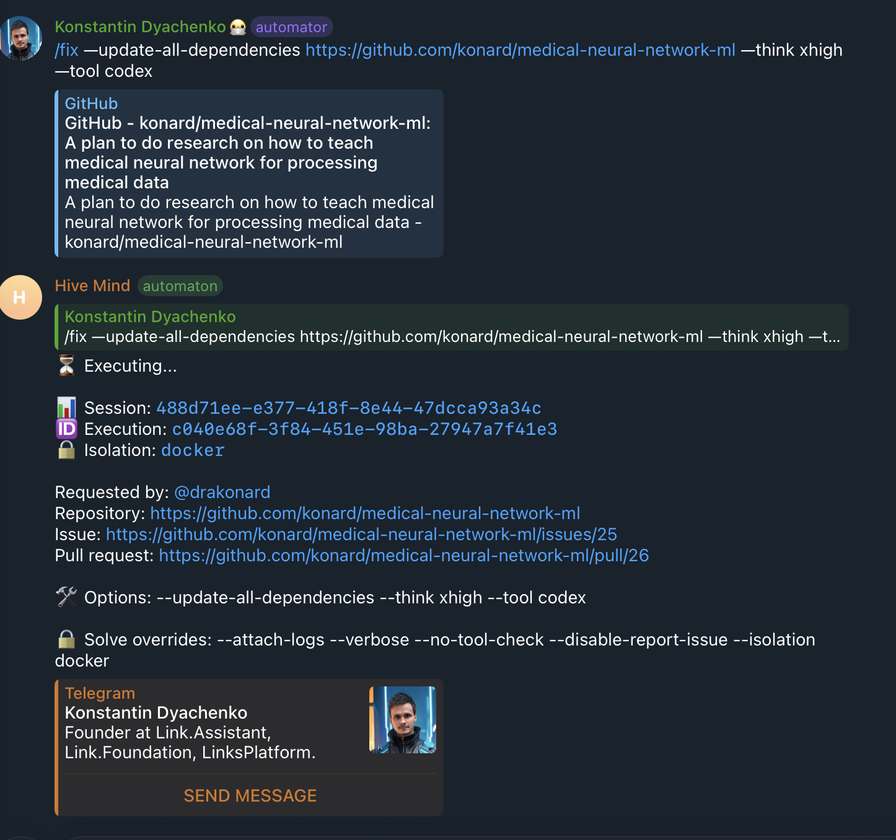
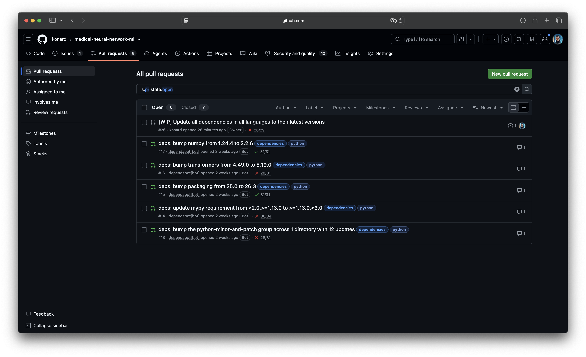

# Case study: `/fix --update-all-dependencies` merged none of the open Dependabot pull requests (issue #3863)

Issue: [link-assistant/hive-mind#3863](https://github.com/link-assistant/hive-mind/issues/3863), "Dependabot pull requests were not merged, before issue creation". Since [issue #3413](../issue-3413/README.md), `/fix --update-all-dependencies` merges every open Dependabot pull request before it creates its dependency-update issue. In [konard/medical-neural-network-ml#25](https://github.com/konard/medical-neural-network-ml/issues/25) it merged none of the five that were open ([#13](https://github.com/konard/medical-neural-network-ml/pull/13)–[#17](https://github.com/konard/medical-neural-network-ml/pull/17)). They were still open after the solver's pull request [#26](https://github.com/konard/medical-neural-network-ml/pull/26) was merged.

## Collected data

Everything is in [`raw/`](raw/):

| File                                                                                                                      | Content                                                                                                                                                     |
| ------------------------------------------------------------------------------------------------------------------------- | ----------------------------------------------------------------------------------------------------------------------------------------------------------- |
| `screenshot-open-dependabot-prs.png`, `screenshot-telegram-fix-command.png`                                               | The two screenshots attached to the issue                                                                                                                   |
| `solve-log-issue-25-sanitized.log`                                                                                        | The solve log linked from the issue (solve v2.39.7, issue #25, PR #26)                                                                                      |
| `issue-25.json`, `pr-26.json`                                                                                             | The generated issue and the solver's pull request                                                                                                           |
| `all-prs.json`                                                                                                            | Every pull request of the target repository                                                                                                                 |
| `pr-{13..17}.json`, `pr-{13..17}-timeline.json`, `pr-{13..17}.diff`                                                       | The five Dependabot pull requests that were left open: metadata (`mergeable`, `mergeStateStatus`), event timelines and diffs                                |
| `pr-18-timeline.json`                                                                                                     | The `github-actions` Dependabot pull request that Dependabot did close by itself                                                                            |
| `base-at-issue-creation.sha`, `base-at-issue-creation-pyproject.toml`, `base-at-issue-creation-unimedvl-requirements.txt` | `main` when issue #25 was created, and the two files the five pull requests change                                                                          |
| `dependabot.yml`, `dependabot-at-4e23b0f8a.yml`, `dependabot-at-c1cb53cae.yml`, `dependabot-yml-history.json`             | The target repository's Dependabot configuration: current, when the pull requests were opened, after they were orphaned, and the commit history of the file |
| `upstream-dependabot-core-16783.md`                                                                                       | The body of the upstream report                                                                                                                             |

The replay in [`experiments/issue-3863-supersession-replay.mjs`](../../../experiments/issue-3863-supersession-replay.mjs) runs the new supersession check on the saved diffs and base files:

```text
#13: superseded=true — torch 2.14.1 ≥ 2.14.1; torchvision 0.29.1 ≥ 0.29.1; triton 3.8.0 ≥ 3.8.0; accelerate 1.15.0 ≥ 1.15.0; …
#14: superseded=true — mypy 2.4.0 ≥ 1.13.0, <3.0
#15: superseded=true — packaging 26.3 ≥ 26.3
#16: superseded=true — transformers 5.20.1 ≥ 5.19.0
#17: superseded=true — numpy 2.5.4 ≥ 2.2.6
```

## Screenshots

The command that created issue #25 (Telegram `/fix --update-all-dependencies … --tool codex`):



The five Dependabot pull requests that were still open afterwards:



## Timeline (UTC)

| Time                   | Event                                                                                                                                                                                                                                                                                                                                                                                                    |
| ---------------------- | -------------------------------------------------------------------------------------------------------------------------------------------------------------------------------------------------------------------------------------------------------------------------------------------------------------------------------------------------------------------------------------------------------- |
| 2026-10-16 17:38       | `4e23b0f8a` adds a Dependabot `pip` entry for `/` and `/docs` with a `python-minor-and-patch` group                                                                                                                                                                                                                                                                                                      |
| 2026-10-16 19:40–19:42 | Dependabot opens #13 (12 updates in `scripts/unimedvl-requirements.txt`), #14 (mypy range in `pyproject.toml`), #15 (packaging), #16 (transformers), #17 (numpy) and #18 (`github-actions`)                                                                                                                                                                                                              |
| 2026-10-17 09:20       | `c1cb53cae` (#19) moves the `pip` entry into the `python` multi-ecosystem group and adds `exclude-paths: scripts/unimedvl-requirements.*`. Four of the five pull requests change that file                                                                                                                                                                                                               |
| 2026-10-17 16:02       | #20 merges and raises the same packages on `main` (`numpy==2.5.4`, `mypy>=2.4.0`, …)                                                                                                                                                                                                                                                                                                                     |
| 2026-10-17 16:07       | Dependabot closes #18: "codecov/codecov-action is no longer updatable, so this is no longer needed". It does nothing on #13–#17                                                                                                                                                                                                                                                                          |
| 2026-10-19 16:42       | `853e94439` adds a `uv` entry for `/scripts`, which now owns the requirements file                                                                                                                                                                                                                                                                                                                       |
| 2026-10-19 17:12–17:13 | The repository owner comments "Superseded …" on each of #13–#17, naming the newer versions on `main`. They stay open                                                                                                                                                                                                                                                                                     |
| 2026-10-19 18:07       | #22 merges (torch 2.14.1, transformers 5.20.1). Every update of #13–#17 is now on `main` at the same or a newer version                                                                                                                                                                                                                                                                                  |
| 2026-10-19, 2026-10-26 | Scheduled Monday Dependabot runs. Nothing is pushed to, commented on or closed in #13–#17                                                                                                                                                                                                                                                                                                                |
| 2026-10-30 15:05:40    | `/fix --update-all-dependencies` (hive-mind 2.39.7) creates #25. `gh pr merge` fails on all five with "the merge commit cannot be cleanly created", is retried with `--admin` and fails again. The issue section is headed "Dependabot pull requests merged before this issue was created" although nothing was merged, and says "Dependabot closes a pull request by itself once its update has landed" |
| 2026-10-30 15:06:29    | The solver opens #26                                                                                                                                                                                                                                                                                                                                                                                     |
| 2026-10-30 16:46:19    | #26 merges, #25 closes. #13–#17 stay open                                                                                                                                                                                                                                                                                                                                                                |
| 2026-10-30             | Issue #3863 is opened with the screenshot of the five open pull requests                                                                                                                                                                                                                                                                                                                                 |
| 2026-11-01             | #13–#17 are still open. Upstream report [dependabot/dependabot-core#16783](https://github.com/dependabot/dependabot-core/issues/16783) is filed                                                                                                                                                                                                                                                          |

## Requirements from the issue

| #   | Requirement                                                                                                                           | Status                                                                                                                                                                                                                                                                                         |
| --- | ------------------------------------------------------------------------------------------------------------------------------------- | ---------------------------------------------------------------------------------------------------------------------------------------------------------------------------------------------------------------------------------------------------------------------------------------------- |
| R1  | Open Dependabot pull requests must not be left open by `/fix --update-all-dependencies` before the issue is created (the issue title) | Done. Conflicting pull requests are closed when the base branch supersedes them, or rebuilt with `@dependabot recreate` and merged. In the #25 replay all five are closed as superseded                                                                                                        |
| R2  | Download all logs and data to `docs/case-studies/issue-3863`                                                                          | Done, see [`raw/`](raw/)                                                                                                                                                                                                                                                                       |
| R3  | Deep case study: timeline, requirements, root causes, solutions and solution plans                                                    | This document                                                                                                                                                                                                                                                                                  |
| R4  | Search online for additional facts, and check existing components and libraries                                                       | See [Alternatives and existing components](#alternatives-and-existing-components) and [References](#references)                                                                                                                                                                                |
| R5  | Add debug and verbose output where data is missing                                                                                    | Done. `--verbose` logs every mergeability refresh, the supersession verdict with the compared versions, the raw `gh pr merge` errors, and each poll while waiting for a recreated pull request. Every close, recreate request and wait outcome is logged without `--verbose`                   |
| R6  | Report issues to other repositories, with a reproducible example, a workaround and a suggested fix                                    | [dependabot/dependabot-core#16783](https://github.com/dependabot/dependabot-core/issues/16783)                                                                                                                                                                                                 |
| R7  | Apply the fix everywhere the problem exists                                                                                           | `/fix` (CLI and Telegram) and Telegram `/task --update-all-dependencies` all go through `mergeDependabotPullRequests`. It is the only code that merges Dependabot pull requests. The solver's own auto-merge (`solve.auto-merge*.lib.mjs`) handles hive-mind's pull requests, not Dependabot's |
| R8  | Everything in a single pull request                                                                                                   | [#3864](https://github.com/link-assistant/hive-mind/pull/3864)                                                                                                                                                                                                                                 |

## Root causes

### RC1: Every open pull request conflicted with a `main` that already had its updates

All five were `mergeable: CONFLICTING`, `mergeStateStatus: DIRTY` (`raw/pr-*.json`). They pin older versions on the same lines that #20 and #22 had already raised (`raw/base-at-issue-creation-*`). No merge method can land them, and the merge is pointless anyway because `main` is already newer.

### RC2: Dependabot no longer looked after them

Dependabot closes a pull request whose update has landed, as it did for #18. The five pull requests were opened by the `pip` entry as it was on 2026-10-16. The next morning that entry was regrouped into a `multi-ecosystem-group`, and `exclude-paths` dropped the requirements file that four of them change. After that, Dependabot never pushed to, commented on or closed any of them (`raw/pr-*-timeline.json`). #14 changes `pyproject.toml`, which is still covered, and it is orphaned too. So the regrouping alone seems to be enough. The Dependabot job logs that would confirm this are not available outside the repository's UI, so this part is an inference from the timelines. It is reported upstream as [dependabot/dependabot-core#16783](https://github.com/dependabot/dependabot-core/issues/16783). Similar older reports, [#7391](https://github.com/dependabot/dependabot-core/issues/7391) and [#13606](https://github.com/dependabot/dependabot-core/issues/13606), were closed without a fix.

### RC3: Hive-mind did not recognize GitHub's wording for a conflict

`shouldRetryWithAdmin` skipped the `--admin` retry only for errors containing "conflict". GitHub reports a conflict as "Pull request … is not mergeable: the merge commit cannot be cleanly created", so each pull request got a second merge attempt with `--admin`. That attempt could not succeed either. Nothing then tried to resolve the conflict.

### RC4: Mergeability that GitHub had not computed yet was taken at face value

GitHub computes `mergeable` lazily, and `gh pr list` can return `UNKNOWN` for pull requests nobody has looked at recently. `UNKNOWN` was treated like `MERGEABLE`, so the conflict only showed up as a failed merge.

### RC5: The generated issue described the result wrongly

The section was always headed "Dependabot pull requests merged before this issue was created", even when nothing was merged. It also said Dependabot would close the open pull requests once their updates landed, which is exactly what did not happen here (RC2). The solver followed the issue, and the pull requests stayed open.

## Solution implemented

### S1: Treat conflicts as conflicts (RC3, RC4)

- `isMergeConflictError` recognizes "conflict", "cannot be cleanly created" and `DIRTY`, and `shouldRetryWithAdmin` returns `false` for them.
- `refreshMergeability` re-reads `UNKNOWN` mergeability with `gh pr view --json mergeable,mergeStateStatus,headRefOid,state`, up to 3 times, 2 s apart.
- A conflict that only shows up when merging, for example after an earlier merge in the same run, goes through the same path as one reported up front.

### S2: Close pull requests that the base branch supersedes (RC1, RC2)

[`src/fix.dependabot-superseded.lib.mjs`](../../../src/fix.dependabot-superseded.lib.mjs) decides whether the base branch already has everything a pull request carries:

1. `gh pr diff` gives the changed manifests. Lockfiles are skipped, because their resolved versions follow the manifests.
2. Every added dependency line is parsed: pip and `pyproject.toml` requirement specifiers, `package.json`, Cargo and other TOML tables, `go.mod`, Gemfile and gemspec, GitHub Actions `uses:` (including the `# vX.Y.Z` comment of a SHA pin), and Docker `FROM`.
3. The same file is read at the base branch (`gh api repos/R/contents/PATH?ref=BASE`). Each dependency must be pinned there at the same or a newer version. When both sides have an upper bound, the base's must not be lower (`mypy>=2.4.0` supersedes `>=1.13.0,<3.0`). Versions compare numerically. Pre-releases rank below their release, post releases above it.
4. The pull request is superseded only if every dependency it changes passes. It is not superseded when the file is missing at the base, when nothing could be parsed, or when every dependency was removed. Any error also counts as "not superseded" and never throws.

A superseded pull request is closed with a comment naming the versions on the base branch, for example `numpy 2.5.4 ≥ 2.2.6`. Dependabot opens a new pull request when a newer version is released.

### S3: Let Dependabot rebuild the rest, and merge it (RC1)

A conflicting pull request that is not superseded gets an `@dependabot recreate` comment. Rebase would replay the old diff onto a branch it conflicts with; recreate regenerates it from the current base. The run then polls each such pull request every 15 s for up to 3 minutes:

- A new head that is mergeable is merged, with the usual `--match-head-commit` and `--admin` retry.
- A new head that still conflicts is reported as failed.
- A pull request that Dependabot closes or merges is reported as such.
- Anything not done in time stays open and is listed in the issue.

`--dry-run` only reports `planned-close` and `planned-recreate`, and touches no pull request.

### S4: Describe the outcome truthfully (RC5)

The section is now "Open Dependabot pull requests handled before this issue was created". It has separate lists for merged, closed as superseded (with the reason) and still open (with the reason, such as "Dependabot was asked to recreate it but had not finished"). The claim that Dependabot closes pull requests by itself is gone. Instead, the solver is asked to apply each still-open update at the same or a newer version, and to list those pull requests as superseded in its description. The next `--update-all-dependencies` run closes them. The console summary counts merged, closed and left-open pull requests.

### Tests

[`tests/fix-dependabot-superseded-3863.test.mjs`](../../../tests/fix-dependabot-superseded-3863.test.mjs) replays the incident from the files in `raw/` through a fake `gh`:

- `UNKNOWN` is refreshed. All five pull requests are closed as superseded. No `--admin` retry and no recreate request is made, and the section lists them as closed.
- "The merge commit cannot be cleanly created" is a conflict, so there is no `--admin` retry.
- A conflicting pull request that is not superseded gets `@dependabot recreate`, and its new head is merged.
- The wait is bounded, and an unfinished recreation stays listed in the issue.
- Dependabot closing the pull request after the recreate request is reported as superseded.
- `--dry-run` makes no `close`, `comment` or `merge` call.
- The version comparison and the dependency-line parsers have unit tests. One of them checks that a CodeQL-flagged input which backtracked exponentially in an earlier draft of the pip pattern ([`experiments/issue-3863-regex-redos.mjs`](../../../experiments/issue-3863-regex-redos.mjs)) is now rejected in linear time.

[`tests/fix-dependabot-merge-3413.test.mjs`](../../../tests/fix-dependabot-merge-3413.test.mjs) is updated for the new heading and the new conflict handling.

## Alternatives and existing components

| Option                                                                                       | Why it was not used as the fix                                                                                                                                                                                                                                                                                                                                                                                                           |
| -------------------------------------------------------------------------------------------- | ---------------------------------------------------------------------------------------------------------------------------------------------------------------------------------------------------------------------------------------------------------------------------------------------------------------------------------------------------------------------------------------------------------------------------------------- |
| Wait for Dependabot to close the pull requests (the old assumption)                          | It does not when the configuration that opened them has changed (RC2, [dependabot-core#16783](https://github.com/dependabot/dependabot-core/issues/16783), [#7391](https://github.com/dependabot/dependabot-core/issues/7391))                                                                                                                                                                                                           |
| `@dependabot rebase`                                                                         | Replays the old diff, so a pull request whose lines changed on the base conflicts again. `@dependabot recreate` rebuilds the update from the base branch ([Dependabot comment commands](https://docs.github.com/en/code-security/reference/supply-chain-security/dependabot-pull-request-comment-commands)). Neither helps when Dependabot ignores the pull request, so supersession is checked first and needs no Dependabot round trip |
| Always `@dependabot close`, or always close conflicting pull requests                        | Throws away updates that the base branch does not have yet. Closing is limited to provable supersession                                                                                                                                                                                                                                                                                                                                  |
| `gh pr update-branch` / GitHub's "Update branch"                                             | Cannot resolve conflicts, only merge the base into a branch that merges cleanly                                                                                                                                                                                                                                                                                                                                                          |
| Resolve the conflict by editing the branch in hive-mind                                      | Rewrites Dependabot's branch, after which Dependabot stops managing it ("edited by someone other than Dependabot"). Lockfiles would also need the ecosystem's tooling. The solver already applies such updates in its own pull request                                                                                                                                                                                                   |
| Renovate (`rebaseWhen: conflicted`, automatic closing of superseded pull requests)           | Handles this natively, but means replacing Dependabot in every target repository                                                                                                                                                                                                                                                                                                                                                         |
| [`semver`](https://www.npmjs.com/package/semver) or a PEP 440 library for version comparison | `semver` rejects PEP 440 and Go/Docker forms such as `2.14.1.post1`, `1.0rc1`, `v1.2.3+incompatible` or `20.11-alpine`. A full PEP 440 library brings no benefit for the "same or newer pin" question, and a dependency in the merge path is a liability. The small comparator is tested on all forms seen here                                                                                                                          |
| Parse manifests with each ecosystem's own parser                                             | Needs every ecosystem's tooling in the `/fix` environment. Line-level parsing of the diff's added lines is enough, because Dependabot changes one pin per line, and any doubt is answered with "not superseded"                                                                                                                                                                                                                          |

## Known limits

- Supersession is decided from manifest pins. A pull request that only changes a lockfile is never considered superseded. It is recreated instead.
- Dependabot may take longer than 3 minutes to recreate a pull request. Those pull requests stay open, are listed in the issue, and are merged or closed by the next run.
- `--admin` still cannot bypass rulesets without bypass actors.

## Upstream report

- [dependabot/dependabot-core#16783](https://github.com/dependabot/dependabot-core/issues/16783): open pull requests are never closed or rebased after their update entry moves into a multi-ecosystem group or `exclude-paths`, although the default branch already has newer versions. The report includes the reproduction from konard/medical-neural-network-ml, the contrast with #18, a workaround and a suggested fix.

## References

- Issue [#3863](https://github.com/link-assistant/hive-mind/issues/3863), pull request [#3864](https://github.com/link-assistant/hive-mind/pull/3864). The feature it fixes comes from [issue #3413](../issue-3413/README.md)
- [konard/medical-neural-network-ml#25](https://github.com/konard/medical-neural-network-ml/issues/25), [#26](https://github.com/konard/medical-neural-network-ml/pull/26), [#13](https://github.com/konard/medical-neural-network-ml/pull/13)–[#18](https://github.com/konard/medical-neural-network-ml/pull/18)
- [GitHub: Dependabot pull request comment commands](https://docs.github.com/en/code-security/reference/supply-chain-security/dependabot-pull-request-comment-commands)
- [GitHub: Dependabot options reference](https://docs.github.com/en/code-security/dependabot/working-with-dependabot/dependabot-options-reference) (`exclude-paths`, `multi-ecosystem-group`)
- [GitHub: Troubleshooting when Dependabot updates stopped](https://docs.github.com/en/code-security/reference/supply-chain-security/troubleshoot-dependabot/dependabot-updates-stopped)
- [GitHub REST API: pull requests](https://docs.github.com/en/rest/pulls/pulls#get-a-pull-request): `mergeable` is computed in the background and can be `null`/`UNKNOWN` at first
- [GitHub CLI manual: `gh pr merge`](https://cli.github.com/manual/gh_pr_merge), [`gh pr diff`](https://cli.github.com/manual/gh_pr_diff)
- [PEP 440: Version identification](https://peps.python.org/pep-0440/)
- [Renovate: `rebaseWhen`](https://docs.renovatebot.com/configuration-options/#rebasewhen)
