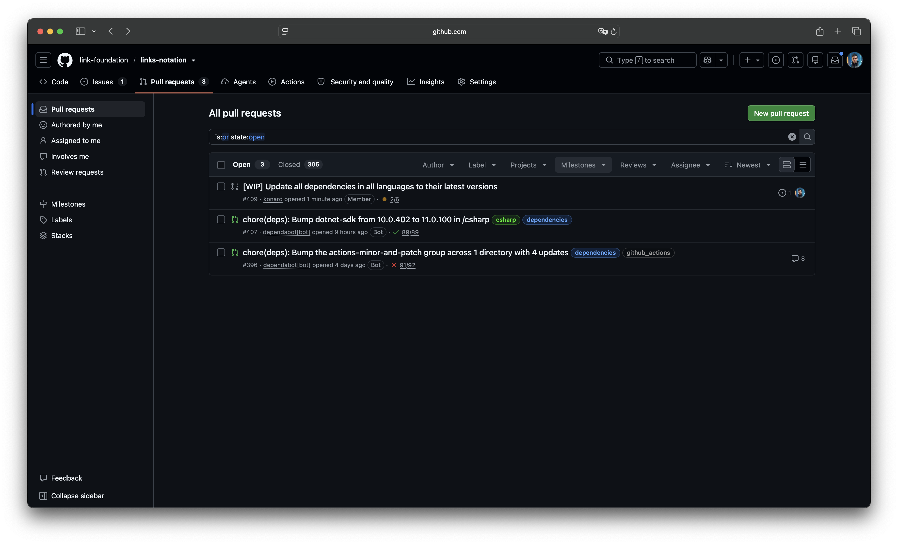

# Case study: `/fix --update-all-dependencies` left two Dependabot pull requests open (issue #4061)

Issue: [link-assistant/hive-mind#4061](https://github.com/link-assistant/hive-mind/issues/4061), "--update-all-dependencies does not handle all dependabot pull requests by default properly (before issue creation)".

The generated issue [link-foundation/links-notation#408](https://github.com/link-foundation/links-notation/issues/408) and its pull request [#409](https://github.com/link-foundation/links-notation/pull/409) were created by `/fix --update-all-dependencies`. Before it creates its issue, that command merges or closes every open Dependabot pull request (see [issue #3413](../issue-3413/README.md) and [issue #3863](../issue-3863/README.md)). It handled neither [#396](https://github.com/link-foundation/links-notation/pull/396) (actions group) nor [#407](https://github.com/link-foundation/links-notation/pull/407) (`dotnet-sdk` 10.0.402 → 11.0.100). Both are still open, although `main` already had every update they carry.



## Collected data

Everything is in [`raw/`](raw/):

| File                                                                                             | Content                                                                                                                            |
| ------------------------------------------------------------------------------------------------ | ---------------------------------------------------------------------------------------------------------------------------------- |
| `issue-408.json`                                                                                 | The generated issue (body, comments, author, creation time)                                                                        |
| `pr-409.json`                                                                                    | The solver's pull request for #408                                                                                                 |
| `solve-log-pr-409-sanitized.log.gz`                                                              | The sanitized solve log of #409 (from the gist linked in its "Solution Draft Log" comment), gzip-compressed                        |
| `pr-396.json`, `pr-396-timeline.json`, `pr-396-comments.json`, `pr-396.diff`                     | Dependabot actions-group pull request: metadata (`mergeable`, `mergeStateStatus`, checks), timeline, comments, diff                |
| `pr-407.json`, `pr-407-timeline.json`, `pr-407-comments.json`, `pr-407-runs.json`, `pr-407.diff` | Dependabot `dotnet-sdk` pull request: the same data plus its workflow runs                                                         |
| `base-at-issue-creation/`                                                                        | The files #396 and #407 change, as they were on `main` at `972d864` when #408 was created                                          |
| `main-commits.json`                                                                              | `main` commits around the incident                                                                                                 |
| `rules-main.json`, `ruleset-24860631.json`                                                       | The rules that apply to `main`: the ruleset "Main requires same-commit ten-language CI"                                            |
| `links-notation-AutoMerge.yml`, `links-notation-merge-dependabot.py`, `automerge-runs.json`      | The target repository's own Dependabot auto-merge workflow and script (at `84f157ed`) and its recent runs                          |
| [`upstream-links-notation-issue.md`](upstream-links-notation-issue.md)                           | The body of the upstream report [link-foundation/links-notation#410](https://github.com/link-foundation/links-notation/issues/410) |

The replay in [`experiments/issue-4061/supersession-at-issue-creation.mjs`](../../../experiments/issue-4061/supersession-at-issue-creation.mjs) runs the current supersession check on the saved diffs and base files:

```text
#396: superseded=true — actions/setup-dotnet 6.1.0 ≥ 6.1.0; actions/setup-java 6.2.0 ≥ 6.2.0; github/codeql-action/init 4.39.3 ≥ 4.39.3; github/codeql-action/analyze 4.39.3 ≥ 4.39.3; trufflesecurity/trufflehog 3.99.9 ≥ 3.99.8
#407: superseded=true — dotnet-sdk 11.0.100 ≥ 11.0.100
```

Before this pull request, the same replay printed `#407: superseded=false — no dependency version change could be read from the diff`, because `global.json` was not parsed.

## Timeline (UTC)

| Time                                | Event                                                                                                                                                                                                                                                                                         |
| ----------------------------------- | --------------------------------------------------------------------------------------------------------------------------------------------------------------------------------------------------------------------------------------------------------------------------------------------- |
| 2026-10-11 01:04                    | Ruleset 24860631 "Main requires same-commit ten-language CI" is created on `main`: ten required checks, `strict_required_status_checks_policy: true` (branches must be up to date), `bypass_actors: []`                                                                                       |
| 2026-10-31 21:18                    | hive-mind v2.39.10 is released                                                                                                                                                                                                                                                                |
| 2026-11-01 13:06                    | hive-mind `3cf8242ae` (#3863) starts closing superseded Dependabot pull requests and changes the issue-body wording; first released in v2.39.11 (16:43)                                                                                                                                       |
| 2026-11-09 22:48                    | Dependabot opens links-notation#396 (actions-minor-and-patch group, 4 updates)                                                                                                                                                                                                                |
| 2026-11-09 23:10 → 2026-11-14 06:43 | links-notation's own `AutoMerge.yml` posts `@dependabot rebase` on #396 five times as `github-actions[bot]`; Dependabot answers "Sorry, only users with push access can use that command." three times                                                                                        |
| 2026-11-13 22:48                    | Dependabot opens links-notation#407 (`dotnet-sdk` 10.0.402 → 11.0.100 in `csharp/global.json`)                                                                                                                                                                                                |
| 2026-11-14 00:57                    | `972d864` (merge of links-notation#406) lands on `main`. From here `main` has every version #396 and #407 set, and #407 is behind `main`                                                                                                                                                      |
| 2026-11-14 08:26:55                 | hive-mind creates links-notation#408. Its body lists #396 as "skipped: merge conflict with the base branch" and #407 as "all 89 check(s) passing — merge failed: GraphQL: Repository rule violations found", and says "Dependabot closes a pull request by itself once its update has landed" |
| 2026-11-14 08:27:05                 | The solve session for #408 starts: `🚀 solve v2.39.10` (solve log, line 6)                                                                                                                                                                                                                    |
| 2026-11-14 08:27:41                 | The solver opens links-notation#409                                                                                                                                                                                                                                                           |
| 2026-11-14 08:31:46                 | The solving agent notes that both Dependabot updates are already on `main`, but does not close #396 or #407                                                                                                                                                                                   |
| 2026-11-14 10:52:19                 | #409 is merged; #408 is closed at 10:52:21                                                                                                                                                                                                                                                    |
| 2026-11-14 (after)                  | #396 and #407 are still open; Dependabot has not closed them, and the `AutoMerge.yml` runs that follow are all `skipped`                                                                                                                                                                      |

## Requirements

| #   | Requirement (from the issue)                                                                                                | Where it is addressed                                                                                                                                                                |
| --- | --------------------------------------------------------------------------------------------------------------------------- | ------------------------------------------------------------------------------------------------------------------------------------------------------------------------------------ |
| R1  | `/fix --update-all-dependencies` must handle **every** open Dependabot pull request before it creates the issue, by default | RC2–RC4 fixes in `src/fix.dependabot-merge.lib.mjs` and `src/fix.dependabot-superseded.lib.mjs`; tests in `tests/fix-dependabot-4061.test.mjs`                                       |
| R2  | Download all logs and data to `docs/case-studies/issue-4061`                                                                | [`raw/`](raw/) (see the table above)                                                                                                                                                 |
| R3  | Reconstruct the timeline                                                                                                    | [Timeline](#timeline-utc)                                                                                                                                                            |
| R4  | List every requirement                                                                                                      | This table                                                                                                                                                                           |
| R5  | Find the root cause of each problem                                                                                         | [Root causes](#root-causes)                                                                                                                                                          |
| R6  | Propose solutions and plans for each requirement                                                                            | [Solutions](#solutions)                                                                                                                                                              |
| R7  | Check existing components and libraries                                                                                     | [Existing components](#existing-components-and-libraries)                                                                                                                            |
| R8  | Search online for more facts                                                                                                | [Sources](#sources)                                                                                                                                                                  |
| R9  | Add debug output or a verbose mode where the data is not enough                                                             | The issue body now names the hive-mind version; full merge errors and the blocking rules are logged; `--verbose` prints every Dependabot decision (see RC1, RC3)                     |
| R10 | Report issues in other repositories, with a reproducible example, a workaround and a suggested fix                          | [link-foundation/links-notation#410](https://github.com/link-foundation/links-notation/issues/410) (RC5)                                                                             |
| R11 | Apply the fix everywhere in the codebase                                                                                    | Every caller of the pre-merge step (`src/fix.mjs`, Telegram `/fix` and `/task`) shares one library; the new option is wired into all of them; the docs in four languages are updated |

## Root causes

### RC1. The bot ran a hive-mind release from before #3863

The #408 body uses two phrases: "Dependabot closes a pull request by itself once its update has landed" and "skipped: merge conflict with the base branch". Both were removed by `3cf8242ae` (#3863, 2026-11-01), which was first released in v2.39.11. So the bot that created #408 on 2026-11-14 ran v2.39.10 or older, which:

- never closed superseded pull requests;
- skipped every conflicting pull request without asking Dependabot to recreate it;
- tried `gh pr merge --admin` once and gave up.

The solve log of #409 ([`raw/solve-log-pr-409-sanitized.log.gz`](raw/solve-log-pr-409-sanitized.log.gz), line 6) confirms it: `🚀 solve v2.39.10` at 08:27:05, ten seconds after #408 was created. The work session of this pull request also reports `solve v2.39.10` ([comment](https://github.com/link-assistant/hive-mind/pull/4062#issuecomment-6877400665)), so the deployment is still on that release.

The stale wording also misled the solving agent. At 08:31:46 it wrote "Both requested Dependabot updates are already included or superseded in the baseline". But the issue said Dependabot closes such pull requests by itself, so nothing asked the agent to close them, and they stayed open after #409 was merged. The current wording ("closed as superseded" / "still open", see #3863) and the closing done by hive-mind itself remove that gap.

Neither the issue nor its body said which version had produced it, so this had to be inferred from the wording and the separate solve log. **Fix (debug output):** the issue context now includes the line `- **Collected by:** hive-mind <version>` (`buildUpdateDependenciesIssueBody({ toolVersion })`, read through `getVersion()`). The next report will name the version directly.

### RC2. Even current code only compared conflicting pull requests with the base branch, and did not parse `global.json`

#3863 added a supersession check, but it ran only for `CONFLICTING` pull requests. #407 was `MERGEABLE` (but `BEHIND`), so current `main` would still have tried to merge it instead of closing it. And `global.json` (the manifest of Dependabot's `dotnet-sdk` ecosystem) was not one of the parsed formats, so the check found "no dependency version change" in #407.

**Fix:** every open Dependabot pull request is now compared with the base branch, whatever its merge state, and closed with a comment when the base already has the same or newer versions. `global.json` `sdk.version` is parsed as dependency `dotnet-sdk`.

### RC3. A behind pull request cannot be merged, even with `--admin`, under a strict ruleset with no bypass

`ruleset-24860631.json` has `strict_required_status_checks_policy: true`, `bypass_actors: []` and `current_user_can_bypass: "never"`. A pull request that is `BEHIND` the base branch is rejected with "GraphQL: Repository rule violations found", and `--admin` does not help, because nobody is on the bypass list. The issue body kept only the first line of that error, which did not say which rule failed.

**Fix:**

- When a merge of a `BEHIND` pull request is rejected, hive-mind posts `@dependabot rebase`. It then waits (bounded by `--dependabot-wait-timeout`, 30 minutes by default) for the new head and its checks, and retries the merge.
- A rebased or recreated pull request whose checks have not been reported yet counts as "waiting for checks", not as failed. A new merge attempt is made only when the check picture changes.
- The full error is kept, and the blocking rules are described. For #407 the description reads: ruleset "Main requires same-commit ten-language CI" requires the branch to be up to date and the status check(s) JavaScript, Rust, … to pass; it cannot be bypassed by the current user (no bypass actors), so `--admin` does not help.

### RC4. The supersession reason of #396 was repeated

`github/codeql-action` appears with the same version in several steps, so the reason listed the same update several times. **Fix:** identical reasons are de-duplicated.

### RC5 (upstream). The target repository's own auto-merge asks Dependabot with a token that Dependabot rejects

links-notation's `scripts/ci/merge-dependabot.py` posts `@dependabot rebase` with `GITHUB_TOKEN` when `DEPENDABOT_AUTO_MERGE_TOKEN` is not usable. Dependabot accepts commands only from users with push access, so every request was rejected, and the script repeated it after each merge (five comments on #396). Reported upstream as [link-foundation/links-notation#410](https://github.com/link-foundation/links-notation/issues/410). The report includes a reproduction, a workaround (a maintainer comments the command, or a working token is stored) and a suggested fix (never comment with `GITHUB_TOKEN`, treat a rejected command as failed, and close superseded pull requests).

## Solutions

| Root cause | Solution in this pull request                                                                                                                                             | Verified by                                                                                                                                                                                                                                                                                                                                                                                                                                             |
| ---------- | ------------------------------------------------------------------------------------------------------------------------------------------------------------------------- | ------------------------------------------------------------------------------------------------------------------------------------------------------------------------------------------------------------------------------------------------------------------------------------------------------------------------------------------------------------------------------------------------------------------------------------------------------- |
| RC1        | The issue context names the hive-mind version                                                                                                                             | `tests/fix-dependabot-4061.test.mjs` ("the generated issue names the hive-mind version that collected it"), `experiments/issue-4061/version-in-body.mjs`                                                                                                                                                                                                                                                                                                |
| RC2        | Every Dependabot pull request is checked for supersession; `global.json` is parsed                                                                                        | Tests: "the .NET SDK pin in global.json is a dependency", "#407 and #396 were both superseded by main when links-notation#408 was created", "superseded pull requests are closed whatever their mergeability, without merging"; the replay above                                                                                                                                                                                                        |
| RC3        | `@dependabot rebase` on `BEHIND` plus rules rejection; bounded wait; retry only when checks change; full error plus rules description; `--dependabot-wait-timeout` option | Tests: "a BEHIND pull request a strict ruleset rejects is rebased by Dependabot, checked and merged", "a rebased pull request whose checks are not reported yet keeps waiting for them" (fails without the fix), "a pull request Dependabot never rebases stays open with the rule that blocked it, after a bounded wait", "the links-notation ruleset is described from the rules API answer", "--dependabot-wait-timeout is parsed by /fix and /task" |
| RC4        | Supersession reasons are de-duplicated                                                                                                                                    | Test: "#407 and #396 were both superseded by main when links-notation#408 was created" (checks that each update of #396 is named once)                                                                                                                                                                                                                                                                                                                  |
| RC5        | Reported upstream                                                                                                                                                         | [links-notation#410](https://github.com/link-foundation/links-notation/issues/410)                                                                                                                                                                                                                                                                                                                                                                      |

Usage: `/fix owner/repo --update-all-dependencies --dependabot-wait-timeout 60` (minutes; `0` disables the wait). The docs are in `README.md` and `docs/DEPENDENCY-UPDATE-BEST-PRACTICES*.md`, in all four languages.

### Limitations

- The bot that handled links-notation#408 runs v2.39.10. It must be upgraded to a release that includes #3863 and this fix before they take effect. That is an operator action outside this repository.
- Dependabot accepts `@dependabot rebase` and `@dependabot recreate` only from a user with push access. If the token hive-mind runs with lacks push access, the command is rejected. The pull request then stays in the "still open" list of the issue, and the wait still ends at its bound.
- If the bypass list is empty, a `BEHIND` pull request cannot be merged before Dependabot rebases it and the required checks pass again. For a repository with long CI, such as the ten-language CI of links-notation, set `--dependabot-wait-timeout` accordingly. A pull request that is still pending at the end of the wait is listed in the issue as still open, together with the reason.

## Existing components and libraries

| Component                                                      | Relevance                                                                                                                                                                                                       |
| -------------------------------------------------------------- | --------------------------------------------------------------------------------------------------------------------------------------------------------------------------------------------------------------- |
| Dependabot comment commands (`@dependabot rebase`, `recreate`) | What hive-mind uses to bring a pull request up to date; they require push access                                                                                                                                |
| Dependabot `rebase-strategy`                                   | Dependabot rebases conflicting pull requests by itself, but not ones that are merely behind, and it stops after 30 days                                                                                         |
| `gh pr update-branch [--rebase]`                               | Updates a branch from the base branch. On a Dependabot branch this adds a commit that is not from Dependabot, so Dependabot stops managing the pull request. hive-mind therefore prefers the Dependabot command |
| GitHub merge queue                                             | Removes the need for "up to date" branches by testing merge groups; it must be enabled by the repository owner                                                                                                  |
| Mergify / Kodiak                                               | Bots that update and merge pull requests. Mergify recommends disabling "require branches to be up to date" or adding itself to the ruleset bypass list                                                          |
| `dependabot/fetch-metadata`                                    | An action that exposes the dependency names and versions of a Dependabot pull request. It could replace diff parsing inside a workflow, but hive-mind works from outside the repository, so it reads the diff   |
| Renovate                                                       | Alternative bot that closes superseded pull requests itself and can rebase "behind" branches (`rebaseWhen: behind-base-branch`)                                                                                 |

## Sources

- [Dependabot pull request comment commands](https://docs.github.com/en/code-security/reference/supply-chain-security/dependabot-pull-request-comment-commands): `rebase` and `recreate`, the thumbs-up acknowledgement, and the note that commands can take several minutes.
- [Managing pull requests for dependency updates](https://docs.github.com/en/code-security/dependabot/working-with-dependabot/managing-pull-requests-for-dependency-updates): automatic rebasing of conflicts, which stops after 30 days or after extra commits are pushed.
- [Creating rulesets for a repository](https://docs.github.com/en/repositories/configuring-branches-and-merges-in-your-repository/managing-rulesets/creating-rulesets-for-a-repository) and [About protected branches](https://docs.github.com/en/repositories/configuring-branches-and-merges-in-your-repository/managing-protected-branches/about-protected-branches): "Require branches to be up to date before merging", and the bypass list.
- [GitHub repository rules are generally available](https://github.blog/news-insights/product-news/github-repository-rules-are-now-generally-available/): layered rulesets and bypass actors.
- [Mergify: GitHub rulesets](https://docs.mergify.com/merge-queue/github-rulesets/): the strict up-to-date setting as a merge blocker, and the bypass-list workaround.
- [Dependabot can now perform version updates for the .NET SDK](https://github.blog/changelog/2024-11-19-dependabot-can-now-perform-version-updates-for-the-net-sdk/) and [Using Dependabot to manage .NET SDK updates](https://devblogs.microsoft.com/dotnet/using-dependabot-to-manage-dotnet-sdk-updates/): the `dotnet-sdk` ecosystem updates `global.json`.
- [global.json overview](https://learn.microsoft.com/en-us/dotnet/core/tools/global-json): the `sdk.version` field.
