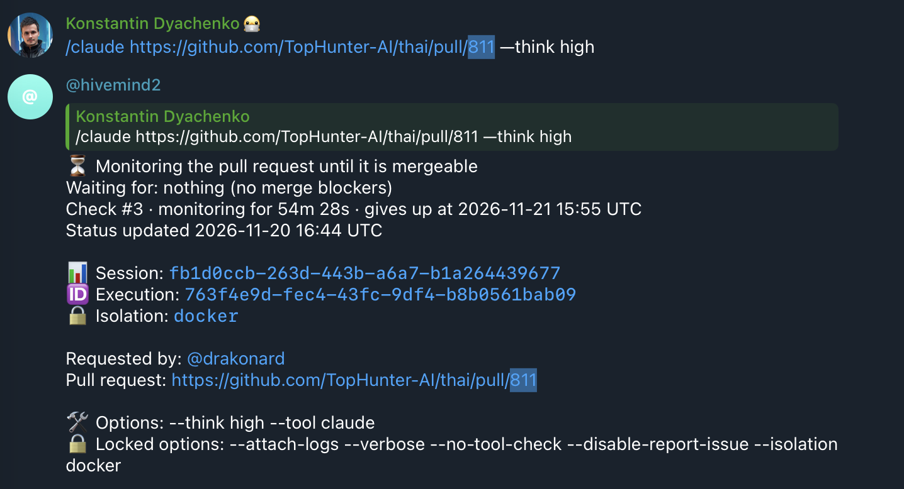
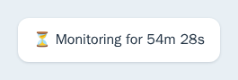

# Issue #4106 · Pull request monitoring continued after readiness

Hive Mind 2.44.0 confirmed that CI passed for the pull request's latest commit, published **Ready to merge**, and then deliberately started a 120-minute review window. The loop was following its own policy. During that window, a GitHub REST rate limit delayed a redundant check by another 26 minutes. Before reporting readiness, a scan of 90 commits also cost 5m 25s. [Issue #4106](https://github.com/link-assistant/hive-mind/issues/4106), [incident log excerpt](data/incident-watch-excerpt.log)

## Timeline

The first two screenshots and the incident logs refer to pull request #811. All times below are UTC on November 20, 2026. [GitHub screenshot](screenshots/github-ready-before.png), [Telegram screenshot](screenshots/telegram-before.png)

| Time              | Event                                                                                                                                                                                                |
| ----------------- | ---------------------------------------------------------------------------------------------------------------------------------------------------------------------------------------------------- |
| 15:54:24          | The AI session finished and began uploading its log.                                                                                                                                                 |
| 15:55:52          | The solution log comment was published. Its footer promised a later **Monitoring Ended** comment.                                                                                                    |
| 15:55:54          | The watcher started with the 120-second cooldown and a 120-minute post-readiness review window.                                                                                                      |
| 15:58:19–15:58:30 | The first poll reported 38 passing checks, five completed and successful workflow runs and a non-draft PR with GitHub merge state `CLEAN`. The watch marker recorded zero merge blockers.            |
| 15:59:29–16:04:55 | The second HEAD snapshot agreed. The watcher then inspected Actions runs on 90 PR commits and consumed about 5m 25s before it could announce success.                                                |
| 16:05:03–16:05:04 | **Ready to merge** appeared on the pull request. The watcher opened a 120-minute review window and scheduled another poll.                                                                           |
| 16:07:15          | The next poll hit a rate limit on the repository REST read. The retry waited until 16:33:30. The server's reset was at 16:20:02, and Hive Mind added 10 minutes of buffer and 208 seconds of jitter. |
| 16:34–16:51       | Polls two and three again found zero blockers. Each repeated the 90-commit scan and deduplicated the readiness comment. The final poll still reported 74 minutes remaining in the review window.     |
| 16:52:23          | The operator stopped the watch. The interrupt log recorded check three and blocker `none`.                                                                                                           |
| 17:20:54          | The pull request was merged.                                                                                                                                                                         |

The third screenshot shows a completed run that posted a standalone **Monitoring Ended** comment after 2h 11m and 18 checks. The screenshot does not identify the PR. PR #811's log instead records a manual stop about 56 minutes into its watch. [Separate completed watch](screenshots/github-monitoring-ended-before.png)

## Why it happened

[#4083](https://github.com/link-assistant/hive-mind/pull/4083) added a two-hour window for late reviews. The success branch posted **Ready to merge**, opened that window, slept and returned to the top of the loop. The stated stop condition and the control flow disagreed. [#4084](https://github.com/link-assistant/hive-mind/pull/4084) already provided a bounded gate for named review apps before readiness. [#4092](https://github.com/link-assistant/hive-mind/pull/4092) made the extended watch visible in Telegram and added a second GitHub completion comment.

The implementation of the older-commit consensus reinforces the delay. It lists the PR's commits, then calls the paginated workflow-runs endpoint once per commit in sequence, including another query for the HEAD. Three polls on this PR meant roughly 270 workflow-list calls before counting extra pages or any of the other GitHub queries. Another per-commit scan in the check-registration path was only used to print diagnostic output, but ran even with verbose logging off. The incident demonstrates request cost and a later rate-limit response. It does not show what share of the account's request budget went to this watcher. The current rate-limit sample is from a different session. [Incident trace](data/incident-watch-excerpt.log), [GitHub REST rate limits](https://docs.github.com/en/rest/using-the-rest-api/rate-limits-for-the-rest-api)

## What GitHub's green check means

GitHub documents two kinds of commit check signals, Checks API runs and legacy commit statuses. Its PR status box evaluates checks against the current head, or against the test merge commit when that commit has statuses. A required check can pass with `success`, `neutral`, or `skipped`. Mergeability also depends on branch rules, reviews and conflicts. GitHub can report `UNKNOWN` while computing mergeability, so an empty or unready response cannot confirm a positive decision. [Status checks](https://docs.github.com/en/pull-requests/reference/status-checks), [Required checks and test merge commits](https://docs.github.com/en/pull-requests/how-tos/merge-and-close-pull-requests/troubleshooting-required-status-checks), [Pull requests REST API](https://docs.github.com/en/rest/pulls/pulls)

GitHub CLI's maintainers describe its PR check query as close to the merge-box view. The REST Checks API answers a commit-scoped question. The workflow runs endpoint can show workflows that have registered before any jobs publish check runs. Actions excludes jobs from some triggers, including `workflow_dispatch`, from the PR status box and required-check evaluation. The endpoint results therefore answer different questions. [GitHub CLI #14253](https://github.com/cli/cli/issues/14253), [GitHub CLI PR checks](https://cli.github.com/manual/gh_pr_checks), [List check runs for a Git reference](https://docs.github.com/en/rest/checks/runs#list-check-runs-for-a-git-reference), [List workflow runs for a repository](https://docs.github.com/en/rest/actions/workflow-runs#list-workflow-runs-for-a-repository)

The follow-up probe on PR #811 uses the same HEAD that the watcher logged and checks that the SHA stayed stable during capture. The GraphQL rollup and REST check-runs endpoint each report 31 successes and seven skips. The CLI PR-check view reports 29 passes and four skips. REST lists five successful PR workflow runs. The commit has zero legacy status contexts, even though the combined legacy endpoint returns `pending`. GitHub had already returned the positive signals during the incident. The wider PR merge state now reads `UNKNOWN` because the follow-up inspected a merged PR. The contemporaneous state in the log was `CLEAN`. [GitHub API capture](data/incident-github-snapshot.json), [Capture script](../../../experiments/issue-4106/capture-github-checks.sh)

## Requirements and verification

| Requirement                                                        | Change and evidence                                                                                                                                                                                                                                                                                                                                                                                                     |
| ------------------------------------------------------------------ | ----------------------------------------------------------------------------------------------------------------------------------------------------------------------------------------------------------------------------------------------------------------------------------------------------------------------------------------------------------------------------------------------------------------------- |
| Stop immediately after publishing readiness                        | The manual-ready branch returns on both publish outcomes. The terminal phase marker closes the watch. The solve epilogue skips a redundant readiness read and work-session status post after a terminal disposition. The source regression test failed against the old branch and verifies the new ordering.                                                                                                            |
| Preserve review and merge safety                                   | The bot wait, unresolved threads, merge prerequisites, no-change check and GitHub mergeability still precede readiness. The extra review window defaults to zero. When explicitly enabled, it runs before the final status and resets on changes or an AI restart. The review-gate and review-app suites cover the preconditions.                                                                                       |
| Keep one GitHub readiness status                                   | Removed the extra completion comment and its promise from the log footer. Historical markers remain recognized for comment filtering. Tests cover comment deduplication, command failure, and terminal reporting without another comment.                                                                                                                                                                               |
| Show elapsed minutes and seconds in one Telegram line              | The watch header only formats total minutes and seconds. Structured logs retain blocker, deadline and check number for diagnostics and `/stop`. Tests cover all four locales, minute and second formatting and refresh behavior. Playwright verified the rendered preview.                                                                                                                                              |
| Remove historical scan delay while checking current CI             | The watcher compares the SHA between the PR state, mergeability and CI reads. It checks Actions runs on that head and retries if HEAD changed or a required API read failed. It no longer enumerates older runs on the success or check-registration path. The bounded no-CI history check and optional repo-wide Actions guard remain. Mocked tests cover one HEAD lookup, a moved head, and a failed Actions request. |
| Investigate limits and GitHub's CI view                            | The timestamped trace and SHA-bound probe above explain which reads were authoritative for this incident and which calls caused delay. The verbose consensus output retains the HEAD and checks. The rate-limit wrapper records its reset, buffer and jitter.                                                                                                                                                           |
| Archive evidence, audit related code and evaluate external reports | This directory contains the issue, PR feedback, reported screenshots, incident evidence and a capture script. The audit covered the manual readiness, automatic merge, review gate, initial log footer, final work session, and Telegram paths. See the upstream assessment below. No required sub-issues were listed.                                                                                                  |

## Design options and upstream assessment

- The CLI already provides `gh pr checks --required` and `--watch`. A single PR view is a useful cross-check. Keeping the HEAD workflow-run query covers the interval before jobs publish checks and supports separate repo-wide gating when requested. The selected fix retains the current dual signal and removes sequential reads of superseded commits. [GitHub CLI PR checks](https://cli.github.com/manual/gh_pr_checks)
- Webhooks can reduce repeated network calls for a deployed GitHub App. A local CLI with only the user's GitHub credentials cannot assume an installed app or a reachable webhook receiver. A hosted listener could use `check_run`, `workflow_run` and `pull_request` events, then reconcile the exact SHA after events or reconnects. [Webhook events and payloads](https://docs.github.com/en/webhooks/webhook-events-and-payloads)
- Octokit's throttling and pagination plugins support serialized requests, retry policies and page traversal. Conditional reads with `ETag` can save primary-rate budget. These approaches can improve transport efficiency. They cannot make a post-readiness policy terminal, and replacing the existing CLI retry layer would add migration scope. [GitHub REST best practices](https://docs.github.com/en/rest/using-the-rest-api/best-practices-for-using-the-rest-api), [Octokit throttling](https://github.com/octokit/plugin-throttling.js), [Octokit pagination](https://github.com/octokit/plugin-paginate-rest.js)
- GitHub CLI #14253 already tracks confusion between PR checks and raw commit checks. GitHub CLI #13972 concerns a queued workflow with active jobs. The reported run had no missing required checks or stuck workflow, and its rate-limit response followed documented behavior. There is no reproducible upstream defect accounting for this incident. The application fixes here address the observed delay. Other historical CI regressions retain their existing protections. [GitHub CLI #14253](https://github.com/cli/cli/issues/14253), [GitHub CLI #13972](https://github.com/cli/cli/issues/13972), [Hive Mind #4048](https://github.com/link-assistant/hive-mind/issues/4048)

All observed readiness inputs are tied to the checked SHA. GitHub does not provide an atomic read-and-post-comment operation. A later push or a new review changes the PR and can require a new run. The case evidence covers the status available when the watcher made its decision.

## Reproduction and artifacts

On the affected release, run `solve <issue URL> --continue --auto-restart-until-mergeable --verbose` with automatic merging off on an open PR with passing HEAD CI. With default settings, the watch posts **Ready to merge**, logs a 120-minute review window, and starts another check. On this branch, the default path returns right after the status comment. Setting a nonzero `--auto-restart-until-mergeable-review-window-minutes` gives time for feedback before posting readiness.

```bash
node --test --test-concurrency=1 \
  tests/issue-4082-review-gate.test.mjs \
  tests/issue-4081-review-bots.test.mjs \
  tests/issue-4048-stuck-ci-consensus.test.mjs \
  tests/issue-4091-stop-and-progress.test.mjs \
  tests/issue-4091-unstarted-ci-runs.test.mjs \
  tests/issue-4091-wait-watchdog.test.mjs

bash experiments/issue-4106/capture-github-checks.sh OWNER/REPO PR
```

| Before · reported Telegram reply                                                                        | After · browser preview of the formatter output                            |
| ------------------------------------------------------------------------------------------------------- | -------------------------------------------------------------------------- |
|  |  |

The private source PR's solution and interruption logs were retrieved and inspected. The archived excerpt retains the monitoring lifecycle and aggregate results with the original line numbers. The full private logs contain unrelated repository and session data and stay with their original source. The earlier public Formal AI attempt did not implement changes, and its full log is already tracked in this repository. [Prior attempt log](../../../dev/log/issues/4106/pulls/4107/sessions/ses_e06164468ffeLSomKDnCqTTFhp/solve.log), [Public issue and feedback](data/work-item-feedback.json)
